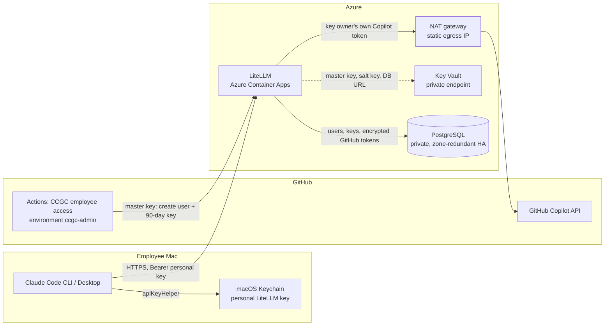
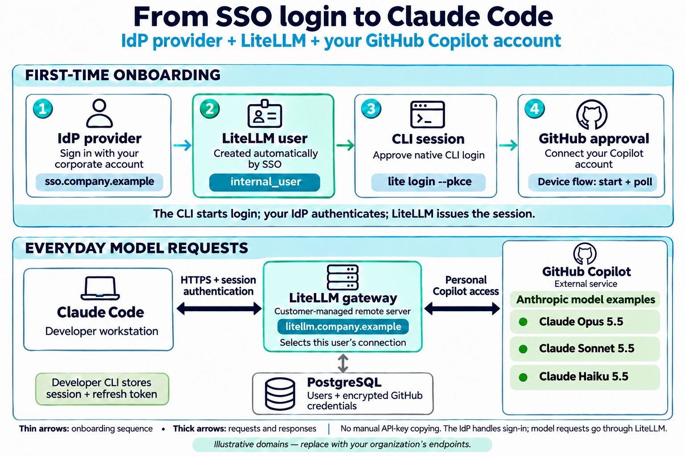

# Claude Code with GitHub Copilot

Run the official, unmodified Claude Code CLI (and Claude Desktop's Gateway
mode) with Claude models supplied by **each employee's own GitHub Copilot
seat**, through one central [LiteLLM](https://github.com/BerriAI/litellm)
gateway on Azure.

- Claude Code talks directly to LiteLLM with a **personal 90-day LiteLLM
  virtual key**. There is no broker, API Management, or custom authentication.
- LiteLLM's native **per-user GitHub Copilot OAuth** credential
  (`github-copilot-user`) resolves every request to the key owner's own GitHub
  connection, so one employee's key can never use another employee's Copilot
  plan.
- Enterprise IT issues and revokes keys from a protected **GitHub Actions**
  workflow. Employees run one macOS script, paste the key, and approve GitHub
  in their browser.

## Architecture



| Step | What happens |
|---|---|
| Enroll | An administrator runs **Actions > CCGC employee access > enroll** with the employee's GitHub username. The workflow resolves the immutable GitHub account ID, creates or reuses a LiteLLM `internal_user`, and issues a 90-day key restricted to the Claude models and inference routes. |
| Set up | The employee runs the setup file from Enterprise IT, which is the macOS script with the deployment's LiteLLM URL built in, pastes the key, and approves GitHub's device flow, which the script starts through LiteLLM. The script checks that the connected GitHub login matches the key owner, verifies the model routes with a small inference request, stores the key in Keychain, and configures Claude Code. |
| Use | Claude Code sends the key to LiteLLM. LiteLLM authenticates it, applies model, budget, and rate policy, records spend under that user, and calls Copilot with that user's own GitHub connection. |
| Revoke | **Actions > CCGC employee access > revoke** disconnects the user's GitHub connection and deletes the LiteLLM user with all its keys. |

### Illustrative SSO flow

The image below depicts an SSO-based variant, not the implemented enrollment
flow. This repository uses GitHub Actions enrollment and personal 90-day
LiteLLM keys; SSO and `lite login --pkce` are not configured. Model names in
the image are illustrative, not the supported catalog.



## Repository layout

| Path | Purpose |
|---|---|
| [`infra/solution.json`](infra/solution.json) | Settings shared by both infrastructure definitions: LiteLLM image, sizes, network ranges, tags |
| [`infra/terraform/`](infra/terraform) | Terraform (`azapi`) definition of the platform; the default deploy engine |
| [`infra/main.bicep`](infra/main.bicep) and [`infra/modules/litellm.bicep`](infra/modules/litellm.bicep) | Equivalent Bicep definition: Container Apps, PostgreSQL, Key Vault, VNet, NAT, private DNS, Log Analytics |
| [`infra/litellm/`](infra/litellm) | LiteLLM config file and the [optional Anthropic routing](#optional-anthropic-routing) hook, mounted into the container by both definitions |
| [`scripts/deploy.mjs`](scripts/deploy.mjs) | Administrator deploy: Terraform state storage behind a network security perimeter, plan or what-if preview, deployment, readiness, bootstrap, GitHub environment |
| [`scripts/litellm-bootstrap.mjs`](scripts/litellm-bootstrap.mjs) | Idempotently registers the per-user Copilot credential and Claude model routes |
| [`.github/workflows/ccgc-employee-access.yml`](.github/workflows/ccgc-employee-access.yml) and [`scripts/enterprise-actions-access.mjs`](scripts/enterprise-actions-access.mjs) | Employee enrollment and revocation |
| [`scripts/employee-access.mjs`](scripts/employee-access.mjs) | `npm run access`: the same enrollment and revocation from an administrator's computer, using the deploy secrets file |
| [`scripts/ccgc-enterprise-macos.sh`](scripts/ccgc-enterprise-macos.sh) | Standalone employee setup for macOS: `enroll`, `doctor`, `models`, `configure`, and `token` (Claude's key helper). It has no gateway built in. |
| [`scripts/build-installer.mjs`](scripts/build-installer.mjs) | `npm run installer`: builds the employee setup file, the macOS script with a deployment's LiteLLM URL built in |
| [`test/`](test) | Synthetic tests for every script |

## Getting started

- [GitHub MCP web search](docs/GITHUB-MCP.md) is included in employee onboarding,
  with automatic GitHub CLI installation and safe reruns.
- [Request/response logging](docs/LOGGING.md) can be enabled through an administrator
  feature flag; content storage is off on new gateways.
- **Administrators:** follow the [enterprise runbook](docs/ENTERPRISE.md) to
  deploy, configure GitHub, and enroll or revoke employees.
- **Employees:** follow the [Mac guide](docs/mac/README.md). You need macOS,
  Claude Code `2.1.296` or newer, a Copilot-entitled GitHub account, and the
  setup file and key from Enterprise IT. No checkout, Node.js, or LiteLLM
  password is needed.

Choose the Azure subscription, region, and resource prefix through the
deployment options. Image and sizing defaults live in
[`infra/solution.json`](infra/solution.json). A confirmed deployment writes
the [employee setup file](docs/ENTERPRISE.md#employee-setup-file) with its
gateway URL built in.

Development checks (Node.js 24, Terraform 1.11 or newer, Azure CLI with Bicep):

```bash
npm ci
npm run check
npm test
terraform fmt -check -recursive infra/terraform
terraform -chdir=infra/terraform init -backend=false
terraform -chdir=infra/terraform validate
terraform -chdir=infra/terraform test
az bicep build --file infra/main.bicep --stdout >/dev/null
az bicep lint --file infra/main.bicep
```

## Compatibility

Model availability depends on each employee's GitHub Copilot entitlement and
organization policy. The default catalog is defined in
[`scripts/litellm-bootstrap.mjs`](scripts/litellm-bootstrap.mjs); administrators
can select models with the deploy script's `--models` option. A model listed by
LiteLLM is not a guarantee of upstream access. Unsupported models fail without
falling back to another provider or account.

Synthetic tests cover deployment, bootstrap, enrollment, and macOS behavior
with fake services. Enrollment and `doctor` check live model discovery and
inference for the selected default model. Other Claude Code features depend
on the client version and model; verify the workflows you need in your
environment.

- Models that require adaptive thinking reject explicit fixed-budget thinking.
- Claude Code omits the Advisor server tool whenever `ANTHROPIC_BASE_URL` points to a custom gateway.
- Auto mode uses Claude Code's local classifier (`CLAUDE_CODE_AUTO_MODE_SERVER=0`) instead of Anthropic-only server verdicts.

### Deployment verification

On 2026-11-17, a fresh Terraform deployment of LiteLLM `1.109.1` in Sweden
Central passed readiness with PostgreSQL connected, two healthy gateway
replicas, private zone-redundant PostgreSQL, authenticated discovery of all five
default models, and rejection of unauthenticated discovery. Per-user Copilot
credential bootstrap, disabled prompt/response storage, GitHub administration
configuration, and employee setup-file generation completed. No employees were
enrolled and no Copilot inference or Claude Code CLI/Desktop workflow was
tested in this deployment.

## Optional Anthropic routing

Off by default. Some Claude Code features need Anthropic's own API, for
example Claude Code's built-in `WebSearch`, which uses Anthropic's server-side
web search. An administrator can let LiteLLM send only those requests to
Anthropic, using **each employee's own claude.ai subscription**. Everything
else stays on that employee's Copilot connection.

| Request from a granted employee | Where LiteLLM sends it |
|---|---|
| Normal requests on a `claude-*` model | The employee's GitHub Copilot connection, as without routing |
| Claude Code web search (an Anthropic `web_search_*` server tool) | Anthropic, as `ccgc-anthropic/<same model>`, with the employee's claude.ai sign-in |
| A session on `ccgc-anthropic/<model>`, for example `claude --model ccgc-anthropic/claude-sonnet-5.5` | Anthropic, with the employee's claude.ai sign-in |

- The hook [`infra/litellm/ccgc_anthropic_routing.py`](infra/litellm/ccgc_anthropic_routing.py)
  is always loaded but does nothing until both of these exist:
  - the routes, created with `deploy.mjs --anthropic-routes true`;
  - a per-employee grant (`anthropic_routing`).
  See the [runbook](docs/ENTERPRISE.md#optional-anthropic-routing).
- The Anthropic routes hold no credential and no API host, so there is no
  shared Anthropic account. LiteLLM forwards only the employee's own claude.ai
  sign-in, and only to Anthropic. A request that needs Anthropic is refused
  with HTTP 400 when Claude Code is not signed in to claude.ai. A Copilot
  failure is never retried on Anthropic.
- The employee runs `claude auth login`, then enrolls with `--anthropic-routing`
  ([Mac guide](docs/mac/README.md#optional-anthropic-routing)). Claude Code's
  Authorization header then carries the claude.ai sign-in, so setup puts the
  personal key in a `x-litellm-api-key` header in `~/.claude/settings.json`
  (mode `0600`). It also sets `CLAUDE_CODE_SUBPROCESS_ENV_SCRUB=1`, so Bash and
  other tool processes do not inherit that header. Claude Desktop stays on
  Copilot.
- This is a deliberate exception to the Copilot-only design. Routed requests
  use the employee's Anthropic plan limits and Anthropic's data terms, and
  bypass Copilot policy. Get company approval before you grant it.

What has been verified (LiteLLM `1.111.0`, Claude Code `2.1.319`; no real
Anthropic account and no Copilot inference were used):

- **Synthetic tests:** the hook, bootstrap, deploy, employee access, and the
  macOS setup script.
- **Real LiteLLM with PostgreSQL 16, local stand-ins for Anthropic and Copilot:**
  - The hook loads.
  - Bootstrap creates, keeps, removes and recreates the routes.
  - Every routing decision works as designed, including refusals without a
    claude.ai sign-in.
  - Removing a grant stops older keys at once.
  - Spend logs record Anthropic requests under the employee with model group
    `ccgc-anthropic/*`. Web search requests that the hook routed are also tagged
    `ccgc-route:anthropic`.
- **Real Claude Code against that LiteLLM**, with settings written by the setup
  script and a placeholder claude.ai token:
  - A `ccgc-anthropic/claude-sonnet-5.5` session reached the Anthropic stand-in.
  - In a session on the Copilot stand-in, only the web search request went to
    the Anthropic stand-in. It carried the claude.ai token and no LiteLLM key.
  - Bash commands did not see the key header. They did see it in a control
    run without subprocess scrubbing.
- **Untested:**
  - a real `claude auth login` sign-in and real Anthropic responses;
  - a real Copilot session combined with Anthropic web search;
  - choosing `ccgc-anthropic/*` models in `/model`;
  - Claude Desktop.

Limits:

- LiteLLM forwards a claude.ai sign-in to *every* route with provider
  `anthropic`, even one with its own API host or key; this was observed in
  testing. Employee keys must reach only the Copilot routes and the
  `ccgc-anthropic/*` routes that bootstrap creates. Setup refuses hybrid
  mode when a key can reach any other model.
- Switching between a `claude-*` and a `ccgc-anthropic/*` model inside one
  conversation may fail on thinking signatures. Start a new session instead.
- Routing does not bring back features that Claude Code turns off for a custom
  `ANTHROPIC_BASE_URL`, such as Remote Control and Advisor. Features that run on
  Anthropic's servers, such as cloud sessions and `/schedule`, never pass
  through LiteLLM.
- The hook uses LiteLLM's internal `get_user_object` and fails closed (HTTP 500)
  if it changes. Re-run the real LiteLLM and real-client checks on every LiteLLM
  upgrade.

## Security properties

- One immutable GitHub account ID maps to one LiteLLM user, one per-user
  Copilot connection, and that user's keys. GitHub tokens are encrypted in
  PostgreSQL with the LiteLLM salt key, and LiteLLM uses them only for the
  key owner.
- Employee keys expire after 90 days and can call only the approved Claude
  models plus the inference, model-info, and own-connection routes. On the Mac
  they are stored only in Keychain, never in the profile or Claude settings.
  The exception is [Anthropic routing](#optional-anthropic-routing), where
  the key is also in the `0600` Claude settings file.
- The LiteLLM master key is a protected GitHub environment secret limited to
  `main`. The administrator copy lives in a private `0600` file. Azure stores
  it in a Key Vault reachable only through a private endpoint.
- PostgreSQL has no public access. Outbound traffic leaves through one static
  NAT IP that GitHub organization IP allow lists can permit.
- The issued key is visible to readers of the Actions run summary. Restrict
  repository access and deliver keys through a private channel.
