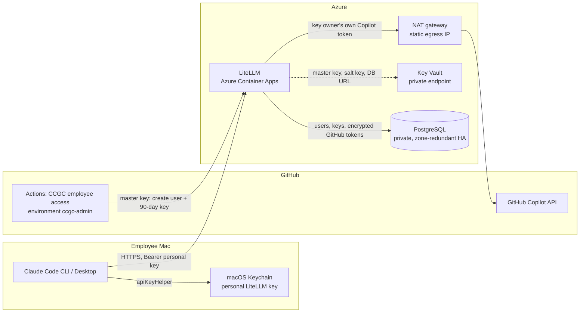
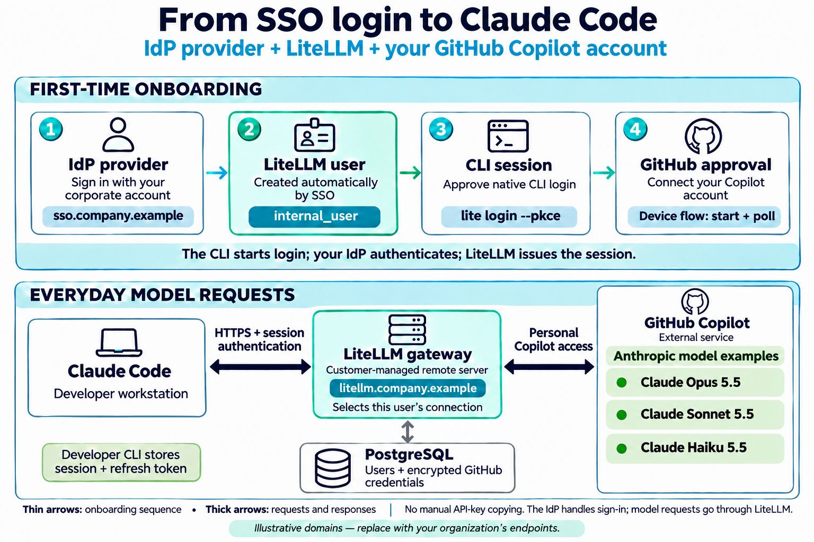

# Claude Code with GitHub Copilot

Run the official, unmodified Claude Code CLI (and Claude Desktop's Gateway
mode) with Claude models supplied by **each employee's own GitHub Copilot
seat**, through one central [LiteLLM](https://github.com/BerriAI/litellm)
gateway on Azure.

- Claude Code talks directly to LiteLLM with a **personal 90-day LiteLLM
  virtual key**. There is no broker, API Management, or custom authentication.
- LiteLLM's native **per-user GitHub Copilot OAuth** credential
  (`github-copilot-user`) resolves every request to the key owner's own GitHub
  connection, so one employee's key can never use another employee's Copilot
  plan.
- Enterprise IT issues and revokes keys from a protected **GitHub Actions**
  workflow. Employees run one macOS script, paste the key, and approve GitHub
  in their browser.

> The GitHub Copilot route is unofficial for this use. Review applicable
> organization and vendor policies before using it.

## Architecture



| Step | What happens |
|---|---|
| Enroll | An administrator runs **Actions > CCGC employee access > enroll** with the employee's GitHub username. The workflow resolves the immutable GitHub account ID, creates or reuses a LiteLLM `internal_user`, and issues a 90-day key restricted to the Claude models and inference routes. |
| Set up | The employee runs the setup file from Enterprise IT, which is the macOS script with the deployment's LiteLLM URL built in, pastes the key, and approves GitHub's device flow, which the script starts through LiteLLM. The script checks that the connected GitHub login matches the key owner, verifies the model routes with a small inference request, stores the key in Keychain, and configures Claude Code. |
| Use | Claude Code sends the key to LiteLLM. LiteLLM authenticates it, applies model, budget, and rate policy, records spend under that user, and calls Copilot with that user's own GitHub connection. |
| Revoke | **Actions > CCGC employee access > revoke** disconnects the user's GitHub connection and deletes the LiteLLM user with all its keys. |

### Illustrative SSO flow

The image below depicts an SSO-based variant, not the implemented enrollment
flow. This repository uses GitHub Actions enrollment and personal 90-day
LiteLLM keys; SSO and `lite login --pkce` are not configured. Model names in
the image are illustrative, not the supported catalog.



## Repository layout

| Path | Purpose |
|---|---|
| [`infra/solution.json`](infra/solution.json) | Settings shared by both infrastructure definitions: LiteLLM image, sizes, network ranges, tags |
| [`infra/terraform/`](infra/terraform) | Terraform (`azapi`) definition of the platform; the default deploy engine |
| [`infra/main.bicep`](infra/main.bicep) and [`infra/modules/litellm.bicep`](infra/modules/litellm.bicep) | Equivalent Bicep definition: Container Apps, PostgreSQL, Key Vault, VNet, NAT, private DNS, Log Analytics |
| [`scripts/deploy.mjs`](scripts/deploy.mjs) | Administrator deploy: Terraform state storage behind a network security perimeter, plan or what-if preview, deployment, readiness, bootstrap, GitHub environment |
| [`scripts/litellm-bootstrap.mjs`](scripts/litellm-bootstrap.mjs) | Idempotently registers the per-user Copilot credential and Claude model routes |
| [`.github/workflows/ccgc-employee-access.yml`](.github/workflows/ccgc-employee-access.yml) and [`scripts/enterprise-actions-access.mjs`](scripts/enterprise-actions-access.mjs) | Employee enrollment and revocation |
| [`scripts/ccgc-enterprise-macos.sh`](scripts/ccgc-enterprise-macos.sh) | Standalone employee setup for macOS: `enroll`, `doctor`, `models`, `configure`, and `token` (Claude's key helper). It has no gateway built in. |
| [`scripts/build-installer.mjs`](scripts/build-installer.mjs) | `npm run installer`: builds the employee setup file, the macOS script with a deployment's LiteLLM URL built in |
| [`test/`](test) | Synthetic tests for every script |

## Getting started

- **Administrators:** follow the [enterprise runbook](docs/ENTERPRISE.md) to
  deploy, configure GitHub, and enroll or revoke employees.
- **Employees:** follow the [Mac guide](docs/mac/README.md). You need macOS,
  Claude Code `2.1.296` or newer, a Copilot-entitled GitHub account, and the
  setup file and key from Enterprise IT. No checkout, Node.js, or LiteLLM
  password is needed.

Choose the Azure subscription, region, and resource prefix through the
deployment options. Image and sizing defaults live in
[`infra/solution.json`](infra/solution.json). A confirmed deployment writes
the [employee setup file](docs/ENTERPRISE.md#employee-setup-file) with its
gateway URL built in.

Development checks (Node.js 24, Terraform 1.11 or newer, Azure CLI with Bicep):

```bash
npm ci
npm run check
npm test
terraform fmt -check -recursive infra/terraform
terraform -chdir=infra/terraform init -backend=false
terraform -chdir=infra/terraform validate
terraform -chdir=infra/terraform test
az bicep build --file infra/main.bicep --stdout >/dev/null
az bicep lint --file infra/main.bicep
```

## Compatibility

Model availability depends on each employee's GitHub Copilot entitlement and
organization policy. The default catalog is defined in
[`scripts/litellm-bootstrap.mjs`](scripts/litellm-bootstrap.mjs); administrators
can select models with the deploy script's `--models` option. A model listed by
LiteLLM is not a guarantee of upstream access. Unsupported models fail without
falling back to another provider or account.

Synthetic tests cover deployment, bootstrap, enrollment, and macOS behavior
with fake services. Enrollment and `doctor` check live model discovery and
inference for the selected default model. Other Claude Code features depend
on the client version and model; verify the workflows you need in your
environment.

- Models that require adaptive thinking reject explicit fixed-budget thinking.
- Claude Code omits the Advisor server tool whenever `ANTHROPIC_BASE_URL` points to a custom gateway.
- Auto mode uses Claude Code's local classifier (`CLAUDE_CODE_AUTO_MODE_SERVER=0`) instead of Anthropic-only server verdicts.

## Security properties

- One immutable GitHub account ID maps to one LiteLLM user, one per-user
  Copilot connection, and that user's keys. GitHub tokens are encrypted in
  PostgreSQL with the LiteLLM salt key, and LiteLLM uses them only for the
  key owner.
- Employee keys expire after 90 days and can call only the approved Claude
  models plus the inference, model-info, and own-connection routes. On the Mac
  they are stored only in Keychain, never in the profile or Claude settings.
- The LiteLLM master key is a protected GitHub environment secret limited to
  `main`. The administrator copy lives in a private `0600` file. Azure stores
  it in a Key Vault reachable only through a private endpoint.
- PostgreSQL has no public access. Outbound traffic leaves through one static
  NAT IP that GitHub organization IP allow lists can permit.
- The issued key is visible to readers of the Actions run summary. Restrict
  repository access and deliver keys through a private channel.
