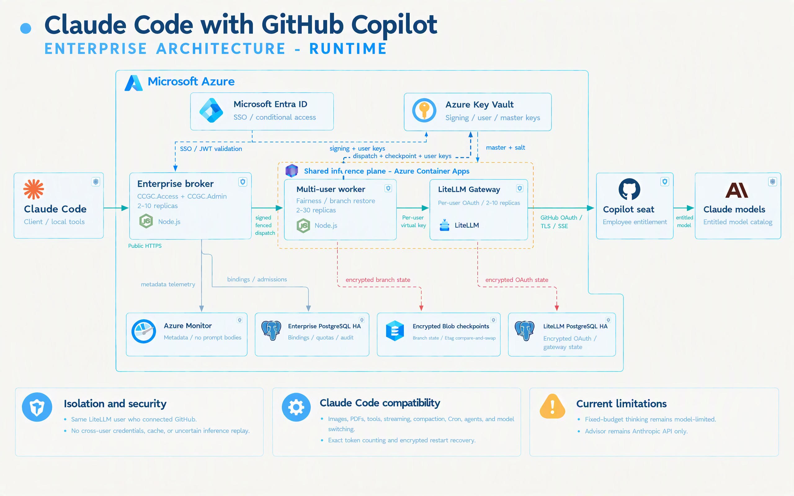

# Enterprise Claude Code with GitHub Copilot

This repository implements an enterprise architecture that lets employees use
the **official Claude Code CLI** with Anthropic models provided through **each
employee's own GitHub Copilot seat**.

```text
Employee Claude Code
        |
        | Microsoft Entra identity
        v
Enterprise admission broker
        |
        v
Multi-user worker Container App (2-30 shared replicas)
        |
        v
LiteLLM Gateway Container App (2-10 shared replicas)
        |
        v
        Employee's GitHub Copilot seat -> Anthropic Models
```

Each employee has a separate identity binding, LiteLLM user key, GitHub OAuth
connection, Copilot authorization, model catalog, admission, limits, and
encrypted conversation checkpoints. The broker and worker retain enterprise
control and state safety; LiteLLM owns per-user GitHub OAuth, Copilot token
exchange, Anthropic Messages transport, streaming conversion, and provider
session caches.

> [!IMPORTANT]
> The enterprise foundation is implemented and locally validated, but it is not
> deployed or approved for production use. The remaining release gates are
> documented in [docs/ENTERPRISE.md](docs/ENTERPRISE.md).

> [!WARNING]
> The Copilot connector is unofficial and is not endorsed by GitHub or
> Anthropic. The organization must approve this use before onboarding employees.

## Why the enterprise path uses LiteLLM and a broker

The enterprise path has two required project components:

| Component | What it is | Why it is required |
|---|---|---|
| Enterprise admission broker | Project-developed TypeScript/Node.js service. | Validates Entra identity, resolves the employee binding, issues bounded admissions, reserves attempts, fences dispatches, and records audit metadata. |
| Shared multi-user worker | Project-developed TypeScript/Node.js service. | Verifies short-lived broker-signed dispatches, enforces per-user fairness, restores encrypted branch checkpoints on any replica, and forwards each call with the bound LiteLLM user key. |
| LiteLLM Gateway | Separate private Container App. | Implements per-user GitHub OAuth, encrypted user connections, Copilot token exchange, Anthropic Messages transport, streaming, token counting, and provider session caching. |

Current LiteLLM Gateway supports **Per-user GitHub OAuth**: each request is
authenticated as the same LiteLLM user who connected GitHub, and each user's
encrypted GitHub connection is stored separately in LiteLLM PostgreSQL. This
removes the custom enterprise device flow, GitHub-token custody, Copilot token
exchange, endpoint validation, and provider transport.

LiteLLM does not replace the broker or worker because it does not implement this
project's Entra-to-GitHub immutable binding, bounded admissions, signed dispatch
fences, per-user branch quotas, encrypted checkpoints, or no-replay state
machine. API Management remains omitted because the broker already owns those
controls.

## Enterprise Azure components

| Component | Purpose |
|---|---|
| Azure Container Apps | Independently scales the public broker (2-10), internal worker (2-30), and internal LiteLLM Gateway (2-10), and runs a one-shot Bicep-managed bootstrap job. |
| Microsoft Entra ID | Authenticates employees and supplies immutable tenant/object identity. |
| Azure Database for PostgreSQL | Uses an Entra-only server for enterprise control state and a dedicated private server for LiteLLM's encrypted OAuth connections and gateway state. |
| Azure Key Vault | Stores account-scoped LiteLLM user keys, LiteLLM master/salt keys, dispatch signing, database connection material, and checkpoint encryption. |
| Azure Blob Storage | Stores client-side-encrypted branch checkpoints with ETag conditional writes. |
| Azure Container Registry | Stores approved immutable broker, worker, and LiteLLM images. |
| NAT Gateway | Gives the private workers controlled, stable outbound connectivity. |
| Azure Monitor and Application Insights | Records operational metadata without prompt or response bodies. |

The broker is the only public service. Employee inference and admission routes
require `CCGC.Access`; lifecycle routes on the same broker require `CCGC.Admin`,
assigned only to the enterprise IT administrator group. LiteLLM, worker, Key
Vault, storage, ACR, both PostgreSQL servers, and the one-shot bootstrap job
remain private. Administrators receive only GitHub's public verification URL
and one-time code during employee connection.

## On the Mac

Each employee needs:

- Official Claude Code `2.1.296`
- The project-developed enterprise `ccgc` command-line helper
- A bounded opaque admission credential stored in macOS Keychain
- `~/.claude/settings.json` pointing Claude Code to the enterprise broker
- A private, non-secret profile containing Entra, GitHub, model, and binding
  metadata

The Mac uses Microsoft Entra to request an admission. GitHub OAuth tokens remain
encrypted in LiteLLM PostgreSQL. The worker loads only the matching LiteLLM user
key from Key Vault.

See [Mac enterprise setup and operation](docs/mac/README.md) for installation,
Entra sign-in, configuration, Keychain behavior, verification, and daily use.

## Claude Code feature compatibility

### Validated features

- Core chat and streaming
- Read, Edit, and Bash
- Model discovery and model switching
- Bounded admission renewal
- Image input and PDF document input
- Adaptive thinking, effort metadata, and thinking-block handling
- Low-effort between-tools thinking
- Exact token counting
- Resume of completed turns across admission renewal and gateway restart
- Resume of an exact pending tool batch after an enterprise worker restart
- Coordinated agents/subagents with isolated branches
- Background Bash tasks and result collection
- Hooks
- Automatic compaction through a real context-limit continuation cycle
- Cron create/list/delete, durable restart, and timed one-shot firing
- Automatic-memory write, persistence, and fresh-session reload
- Auto permission mode through Claude Code's local classifier

| Feature | Status | Why |
|---|---|---|
| Explicit fixed-budget thinking | **Not supported by the current model** | The current Sonnet model requires adaptive thinking and rejects `thinking.type: enabled` with an explicit token budget. |
| Advisor tool | **Anthropic API only** | Claude Code `2.1.296` supports Advisor, but deliberately omits the `advisor_20260301` server tool when `ANTHROPIC_BASE_URL` points to this custom Copilot gateway. |

Validated features have automated coverage and, where applicable, a live
gateway proof. The table contains only behavior that remains unavailable,
model-limited, or short of its complete stateful release scenario.

Auto mode remains opt-in: the generated profile sets
`CLAUDE_CODE_AUTO_MODE_SERVER=0` so Claude Code uses its reviewed local
classifier instead of requesting Anthropic-only server safeguard verdicts.
Normal allow/deny rules and explicit approvals remain authoritative.

## Developer validation

Requirements:

- macOS for the enterprise client and Keychain integration
- Node.js 24
- npm
- Docker
- Azure CLI and Bicep for infrastructure validation

```bash
npm ci
npm run check
npm test
npm run test:bootstrap
npm run test:client

docker build -f server/Dockerfile.enterprise -t ccgc-enterprise-broker:test .
docker build -f server/Dockerfile.enterprise-worker -t ccgc-enterprise-worker:test .
docker build -f server/Dockerfile.enterprise-litellm -t ccgc-enterprise-litellm:test .

az bicep build --file infra/enterprise/main.bicep --stdout > enterprise.json
checkov -d infra/enterprise --framework bicep --skip-download --compact \
  --skip-check CKV_AZURE_43
```

The PostgreSQL integration test runs when `CCGC_TEST_POSTGRES_URL` is set.
`CKV_AZURE_43` is skipped because Checkov cannot evaluate the Bicep
`take(...uniqueString...)` storage name expression; the expression is lowercase
alphanumeric and capped at Azure's 24-character limit.

The LiteLLM image pins both its base digest and an upstream source commit/archive
hash. The source overlay supplies the per-user GitHub OAuth routes and database
migration that are not yet in the pinned published image. A non-secret invalid
Copilot token sentinel permits router initialization only; disconnected users
still fail closed before any upstream request, and real per-user sessions
replace the sentinel on connected requests.

## Enterprise pilot automation

The pilot exposes one Entra-authenticated broker to the public internet. Worker
and LiteLLM ingress and every data service remain private. The assignment-required
Enterprise Application gives the employee group only `CCGC.Access` and the IT
administrator group only `CCGC.Admin`; the broker validates the required role
independently for inference and administration routes.

```bash
npm run enterprise:entra -- \
  --display-name 'CCGC Enterprise API' \
  --pilot-group-object-id 00000000-0000-0000-0000-000000000000 \
  --admin-group-object-id 11111111-1111-1111-1111-111111111111 \
  --confirm-entra-changes

npm run enterprise:pilot -- foundation \
  --parameters /private/path/enterprise.parameters.json
npm run enterprise:pilot -- foundation \
  --parameters /private/path/enterprise.parameters.json \
  --confirm-deploy

npm run enterprise:pilot -- images \
  --parameters /private/path/enterprise.parameters.json

npm run enterprise:pilot -- runtime \
  --parameters /private/path/enterprise.parameters.json \
  --images .azure/enterprise-images.GIT_SHA.json
npm run enterprise:pilot -- runtime \
  --parameters /private/path/enterprise.parameters.json \
  --images .azure/enterprise-images.GIT_SHA.json \
  --confirm-deploy
```

The no-confirm variants run Azure `what-if`. Foundation deployment creates the
private Premium ACR and scale-to-zero VNet build pool first; image publication
then produces digest-only references consumed by runtime deployment.

## LiteLLM bootstrap and employee onboarding

The confirmed runtime deployment starts the private Bicep-defined bootstrap job
after the Container Apps revision is created. The job initializes the
Entra-only control database, grants the broker its required database rights,
and idempotently creates the LiteLLM per-user OAuth credential and approved
`github_copilot/<model>` mappings. No public bootstrap endpoint or manual
database command exists.

Employee onboarding then has two approvals. The employee key must belong to a
LiteLLM `internal_user`; an unowned raw virtual key cannot use the per-user
connection endpoints.

### 1. Administrator connects the employee's GitHub account

Create the employee's LiteLLM `internal_user` and its private output file, then
start the device flow through the broker's `CCGC.Admin` lifecycle routes while
the employee is present:

```bash
npm run enterprise:manage -- create-user \
  --url https://PUBLIC_BROKER_FQDN \
  --audience api://ENTRA-APPLICATION-ID \
  --input /private/path/create-user.json \
  --output /private/path/created-user.json
npm run enterprise:manage -- connect \
  --url https://PUBLIC_BROKER_FQDN \
  --audience api://ENTRA-APPLICATION-ID \
  --input /private/path/connect-user.json
```

The command displays GitHub's public verification URL and one-time code, polls
until completion, verifies the active Copilot seat, and fails if the connected
GitHub login differs from `connect-user.json`. Input files must be user-owned
mode-0600 regular files; `create-user` creates its output exclusively with mode
0600.

### 2. Administrator links the employee

The administrator verifies that the Entra principal and GitHub account belong to the
same employee, then writes the approved private binding:

```bash
npm run enterprise:manage -- link \
  --url https://PUBLIC_BROKER_FQDN \
  --audience api://ENTRA-APPLICATION-ID \
  --input /private/path/link.json
```

`link.json` supplies the immutable Entra and GitHub IDs, approved models,
`litellmCredentialName`, and the employee's LiteLLM user key. The admin command
first verifies `/credentials/user_connections` reports that the key is connected
to the confirmed GitHub login, then stores the key in Key Vault. Updating a
binding increments its revision and revokes existing admissions.

### 3. Employee configures the Mac

```bash
npm run enterprise:client -- login \
  --gateway https://PUBLIC_BROKER_FQDN \
  --audience api://ENTRA-APPLICATION-ID

npm run enterprise:client -- configure
npm run enterprise:client -- configure --apply
npm run enterprise:client -- models
claude
```

`DefaultAzureCredential` must resolve to the intended employee. Production
deployment must define the approved Entra credential source and local token
cache policy.

## Security properties

- One immutable Entra principal maps to one immutable GitHub account.
- Every employee uses their own Copilot seat.
- Admission tokens are random, bounded, hashed server-side, and stored locally
  only in macOS Keychain.
- PostgreSQL atomically reserves attempts and creates monotonic dispatch fences.
- Broker-signed, 60-second dispatch assertions bind tenant, principal, account,
  credential reference, binding revision, admission, branch, model, fence, and
  dispatch ID.
- Shared workers reject invalid assertions, duplicate dispatch IDs, stale
  branch fences, cross-account state, model drift, and per-user saturation.
- Each dispatch uses only the bound LiteLLM user key; LiteLLM resolves the
  corresponding encrypted GitHub connection and keeps Copilot sessions
  user-scoped.
- Conversation checkpoints are encrypted before private Blob Storage and use
  ETag compare-and-swap to detect concurrent writers.
- Broker and worker do not retry inference.
- Prompt and response bodies are not logged or stored by the broker.
- No provider fallback or cross-user response cache is used.

## Deployment status and remaining gates

No enterprise Azure resources have been deployed from this repository.
Production deployment still requires:

1. Entra API registration, permissions, and Conditional Access approval
2. Private PostgreSQL administrator/bootstrap flow
3. Built, scanned, signed, and immutable broker, worker, and LiteLLM images
4. Approved LiteLLM license/edition and user-key lifecycle
5. Live two-user, revocation, load, replica-failure, restore, and noisy-neighbor testing
6. Monitoring privacy review
7. Azure cost and change-plan approval
8. Vendor and organization approval for the unofficial Copilot route

The foundation must not be described as production-ready until these gates pass.

## Architecture poster



The current poster and technical architecture show one public Entra-authorized broker
with separate `CCGC.Access` and `CCGC.Admin` route groups and one shared Azure
Container Apps inference-plane boundary containing the independently scaled
multi-user worker and LiteLLM Gateway apps. The runtime-only poster
also includes the separate enterprise and LiteLLM databases, private Key Vault,
and encrypted checkpoint store. The reviewed Archify JSON and interactive HTML
remain the authoritative technical architecture; the GPT-image poster is its
presentation companion. Diagram sources, model provenance, and validation
receipts are in [docs/diagrams](docs/diagrams/README.md).

## Documentation

| Document | Purpose |
|---|---|
| [docs/ENTERPRISE.md](docs/ENTERPRISE.md) | Enterprise architecture, implementation, onboarding, and release gates |
| [docs/mac/README.md](docs/mac/README.md) | Employee Mac setup and daily operation |
| [docs/PRD.md](docs/PRD.md) | Product and security contract |
| [docs/diagrams/README.md](docs/diagrams/README.md) | Diagram sources and provenance |
