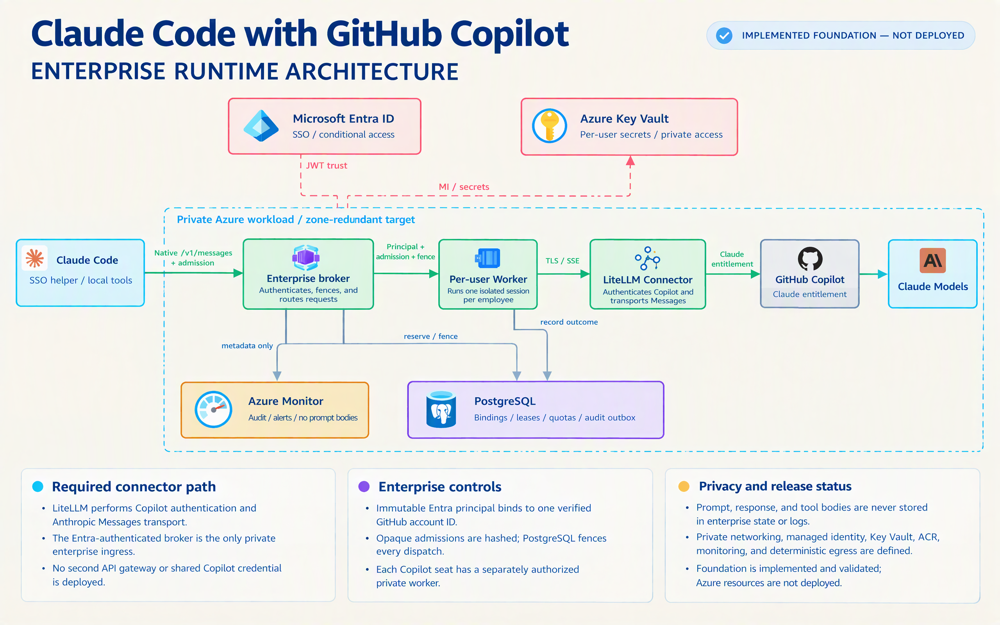

# Enterprise Claude Code with GitHub Copilot

This repository implements an enterprise architecture that lets employees use
the **official Claude Code CLI** with Anthropic models provided through **each
employee's own GitHub Copilot seat**.

```text
Employee Claude Code
        |
        | Microsoft Entra identity
        v
Enterprise admission broker
        |
        v
Isolated per-user worker
        |
        v
LiteLLM -> Employee's GitHub Copilot seat -> Anthropic Models
```

Each employee has a separate identity binding, worker, Copilot authorization,
credential cache, model catalog, admission, limits, and conversation state.
Seats and credentials are never pooled.

> [!IMPORTANT]
> The enterprise foundation is implemented and locally validated, but it is not
> deployed or approved for production use. The remaining release gates are
> documented in [docs/ENTERPRISE.md](docs/ENTERPRISE.md).

> [!WARNING]
> The Copilot connector is unofficial and is not endorsed by GitHub or
> Anthropic. The organization must approve this use before onboarding employees.

## Why both the broker and LiteLLM are needed

They perform different required jobs:

| Component | What it is | Why it is required |
|---|---|---|
| Enterprise admission broker | Project-developed TypeScript/Node.js service. | Validates Entra identity, resolves the employee binding, issues bounded admissions, reserves attempts, fences dispatches, and records audit metadata. |
| Isolated per-user worker | Project-developed TypeScript/Node.js service. | Enforces one employee's identity, admission, model catalog, dispatch order, and conversation state before inference. |
| [LiteLLM](https://github.com/BerriAI/litellm) | Third-party open-source model gateway. | Handles the employee's GitHub Copilot authorization, token refresh, model discovery, and Anthropic Messages transport. |

The broker cannot replace LiteLLM's Copilot authentication and transport.
LiteLLM cannot replace the broker's enterprise identity, admission, isolation,
fencing, and audit controls.

API Management is not included because it does not replace either required
component.

## Enterprise Azure components

| Component | Purpose |
|---|---|
| Azure Container Apps | Runs the internal broker and isolated per-user workers. |
| Microsoft Entra ID | Authenticates employees and supplies immutable tenant/object identity. |
| Azure Database for PostgreSQL | Stores user bindings, admission state, attempt reservations, dispatch fences, and audit intent. |
| Azure Key Vault | Resolves each employee's private worker endpoint and broker credential. |
| Azure Container Registry | Stores approved immutable broker and worker images. |
| NAT Gateway | Gives the private workers controlled, stable outbound connectivity. |
| Azure Monitor and Application Insights | Records operational metadata without prompt or response bodies. |

The broker is the only enterprise ingress. Workers, PostgreSQL, Key Vault, and
the registry remain private.

## On the Mac

Each employee needs:

- Official Claude Code `2.1.284`
- The project-developed enterprise `ccgc` command-line helper
- A bounded opaque admission credential stored in macOS Keychain
- `~/.claude/settings.json` pointing Claude Code to the enterprise broker
- A private, non-secret profile containing Entra, GitHub, model, and binding
  metadata

The Mac uses Microsoft Entra to request an admission. GitHub and Copilot
credentials remain inside that employee's isolated worker.

See [Mac enterprise setup and operation](docs/mac/README.md) for installation,
Entra sign-in, configuration, Keychain behavior, verification, and daily use.

## Claude Code feature compatibility

Core chat, streaming, Read, Edit, Bash, model discovery, model switching, and
bounded admission renewal are covered by automated tests.

| Feature | Status | Why |
|---|---|---|
| Image input | **Working** | Native base64 image blocks pass gateway validation and completed a live Claude inference through LiteLLM and Copilot. |
| Document/PDF input | **Working** | Native base64 PDF blocks completed a live Claude inference through the full gateway route. |
| Extended thinking | **Working with model limits** | Claude Code adaptive thinking, effort metadata, thinking cleanup, and thinking response blocks are supported. The current Sonnet model rejects explicit fixed-budget thinking and requires adaptive thinking instead. |
| Automatic compaction | **Not fully verified** | Claude Code clear-thinking context management works, but a real context-limit compaction cycle has not completed the release gates. Arbitrary same-admission history replacement remains blocked. |
| Resume across admissions | **Working for completed turns** | A persisted Claude conversation resumed successfully after closing one admission and creating another. Resume while a tool batch is pending remains unsupported. |
| Resume after worker restart | **Working for completed turns** | A persisted conversation resumed after gateway restart, explicit profile refresh, and re-admission. Pending-tool recovery remains unsupported. |
| Agents/subagents | **Working** | Agent IDs receive isolated history/replay state under one admission. A real Claude Code subagent completed through the live gateway. |
| Agent teams | **Partially verified** | The gateway supports the main branch plus eight isolated agent branches with one shared admission limit. A single live subagent passed; a coordinated multi-agent team has not completed release testing. |
| Background tasks | **Working** | The Mac disable flag was removed, and a live Claude Code background Bash task completed and was collected successfully. |
| Hooks | **Working** | The project no longer forces `disableAllHooks`; official-client integration tests verify a configured hook runs without entering model content. |
| Cron | **Not available in this client** | The project no longer disables cron, but official Claude Code `2.1.284` does not expose a native cron command/tool that can be verified. |
| Automatic memory | **Enabled, not fully verified** | The project no longer disables automatic memory, but a controlled write-and-reload lifecycle has not completed release testing. |
| Advisor tool | **Not working in this client** | The project no longer disables Advisor, but live Claude Code `2.1.284` did not expose the `Advisor` tool even when explicitly allowed. |
| Exact token counting | **Working** | `/v1/messages/count_tokens` is forwarded to LiteLLM/Copilot, validates the response, and returned an exact live count. |

Statuses marked working have automated coverage and, where stated, a live
gateway proof. “Not fully verified” means the feature is no longer deliberately
disabled but has not passed its complete stateful release scenario.

## Developer validation

Requirements:

- macOS for the enterprise client and Keychain integration
- Node.js 24
- npm
- Docker
- Azure CLI and Bicep for infrastructure validation

```bash
npm ci
npm run check
npm test
npm run test:bootstrap
npm run test:client

docker build -f server/Dockerfile.enterprise -t ccgc-enterprise-broker:test .
docker build -f server/Dockerfile.enterprise-worker -t ccgc-enterprise-worker:test .

az bicep build --file infra/enterprise/main.bicep --stdout > enterprise.json
checkov -f enterprise.json --framework arm --skip-download --compact
```

The PostgreSQL integration test runs when `CCGC_TEST_POSTGRES_URL` is set.

## Employee onboarding

Onboarding has two separate approvals.

### 1. Operator links the employee

The operator verifies that the Entra principal and GitHub account belong to the
same employee, then writes the approved private binding:

```bash
export CCGC_POSTGRES_URL='postgresql://BROKER_ID@PRIVATE_HOST:5432/postgres?sslmode=require'
export CCGC_KEY_VAULT_URL='https://PRIVATE_VAULT.vault.azure.net/'

npm run enterprise:admin -- link --confirm-same-user \
  < /private/path/link.json
```

The binding contains the immutable Entra and GitHub IDs, approved models, and
that employee's private worker reference. Updating a binding increments its
revision and revokes existing admissions.

### 2. Employee configures the Mac

```bash
npm run enterprise:client -- login \
  --gateway https://PRIVATE_GATEWAY \
  --audience api://ENTRA-APPLICATION-ID

npm run enterprise:client -- configure
npm run enterprise:client -- configure --apply
npm run enterprise:client -- models
claude
```

`DefaultAzureCredential` must resolve to the intended employee. Production
deployment must define the approved Entra credential source and local token
cache policy.

## Security properties

- One immutable Entra principal maps to one immutable GitHub account.
- Every employee uses their own Copilot seat.
- Admission tokens are random, bounded, hashed server-side, and stored locally
  only in macOS Keychain.
- PostgreSQL atomically reserves attempts and creates monotonic dispatch fences.
- Per-user workers reject wrong principals, stale fences, model drift, and
  excess admissions.
- Broker and worker do not retry inference.
- Prompt and response bodies are not logged or stored by the broker.
- No provider fallback, response cache, or shared credential pool is used.

## Deployment status and remaining gates

No enterprise Azure resources have been deployed from this repository.
Production deployment still requires:

1. Entra API registration, permissions, and Conditional Access approval
2. Private PostgreSQL administrator/bootstrap flow
3. Built, scanned, signed, and immutable broker/worker images
4. Private employee worker lifecycle automation
5. Two-user isolation, revocation, load, failure, and restore testing
6. Monitoring privacy review
7. Azure cost and change-plan approval
8. Vendor and organization approval for the unofficial Copilot route

The foundation must not be described as production-ready until these gates pass.

## Architecture poster



Diagram sources and generation receipts are in
[docs/diagrams](docs/diagrams/README.md).

## Documentation

| Document | Purpose |
|---|---|
| [docs/ENTERPRISE.md](docs/ENTERPRISE.md) | Enterprise architecture, implementation, onboarding, and release gates |
| [docs/mac/README.md](docs/mac/README.md) | Employee Mac setup and daily operation |
| [docs/PRD.md](docs/PRD.md) | Product and security contract |
| [docs/diagrams/README.md](docs/diagrams/README.md) | Diagram sources and provenance |
