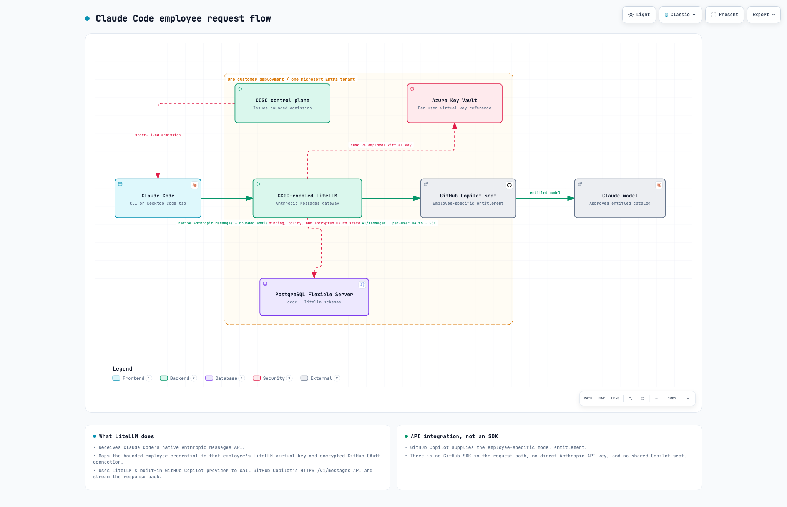
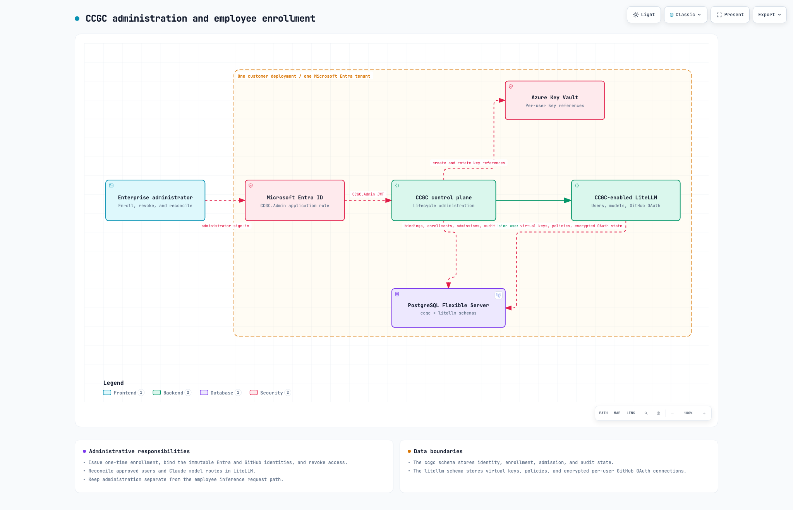
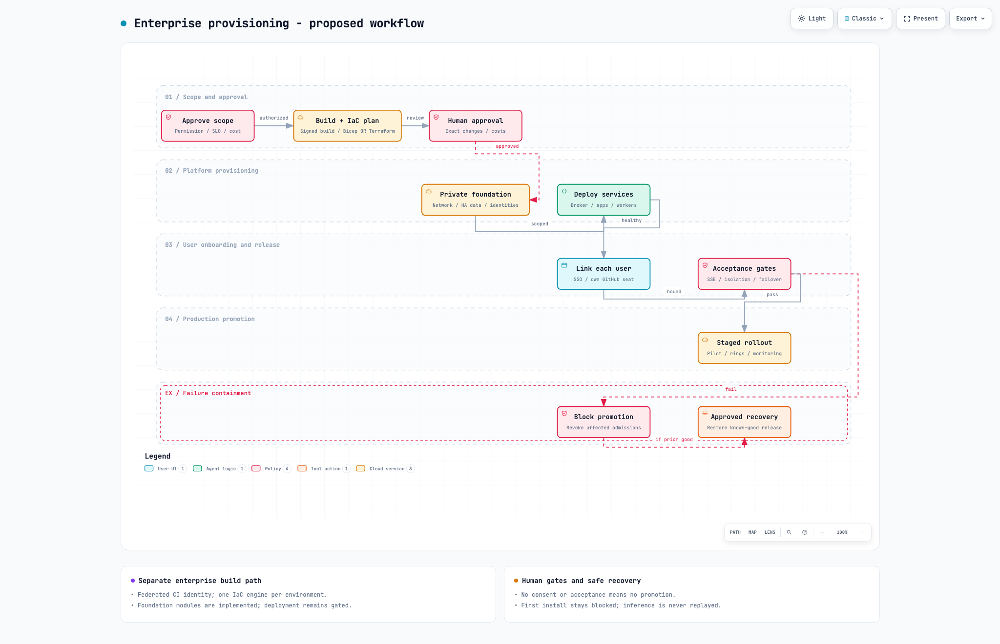

 &nbsp;  &nbsp; 


# Enterprise Claude Code with GitHub Copilot

This repository implements an enterprise architecture that lets employees use
the **official Claude Code CLI** with Anthropic models provided through **each
employee's own GitHub Copilot seat**.

---

## Table of Contents

- [Architecture](#architecture)
- [Why central LiteLLM](#why-the-enterprise-path-uses-central-litellm)
- [Enterprise Azure components](#enterprise-azure-components)
- [Employee setup](#on-the-mac)
- [Claude Code feature compatibility](#claude-code-feature-compatibility)
- [Prerequisites](#prerequisites)
- [Getting started](#getting-started)
- [Developer validation](#developer-validation)
- [Project structure](#project-structure)
- [Enterprise pilot automation](#enterprise-pilot-automation)
- [Employee onboarding](#litellm-bootstrap-and-employee-onboarding)
- [Security properties](#security-properties)
- [Known limitations](#known-limitations)
- [Deployment status and remaining gates](#deployment-status-and-remaining-gates)
- [Resources](#resources)

---

## Architecture

[Open the interactive layered architecture dashboard](docs/diagrams/ccgc-layered-architecture.html)
to switch between the employee flow, the combined user/admin view, and the
administration-only view.

### Employee request flow

[Open the interactive employee runtime diagram](docs/diagrams/ccgc-employee-runtime.html).



Each installation serves exactly one customer and one Microsoft Entra tenant.
Claude Code sends the native Anthropic Messages API to CCGC-enabled LiteLLM.
The CCGC authentication extension resolves the employee's bounded credential
to that employee's LiteLLM virtual key and encrypted GitHub OAuth connection.
LiteLLM's built-in GitHub Copilot provider then calls GitHub Copilot's HTTPS
`/v1/messages` API using the employee's Copilot authorization and streams the
Anthropic-compatible response back to Claude Code.

This is an HTTPS API integration, not a GitHub SDK and not direct access to the
Anthropic API. GitHub Copilot supplies the employee-specific model entitlement;
the solution uses neither a shared Copilot seat nor a separate Anthropic API
key.

### Administration and enrollment

[Open the interactive administration diagram](docs/diagrams/ccgc-admin-control-plane.html).



The separate CCGC control plane handles administrator sign-in, one-time
enrollment, immutable Entra-to-GitHub binding, revocation, bounded admission
issuance, and LiteLLM user/model reconciliation. It does not proxy inference.
The legacy broker-to-worker inference path is disabled by default and retained
only as an explicit migration rollback.

> [!IMPORTANT]
> The Azure pilot now runs the central-LiteLLM architecture with one managed
> PostgreSQL Flexible Server containing separate `ccgc` and `litellm` schemas.
> The control plane and LiteLLM each run two healthy replicas, and live Claude
> Code CLI and Desktop Code-tab inference have passed. This remains an
> enterprise pilot; production rollout still requires the release gates in
> [docs/ENTERPRISE.md](docs/ENTERPRISE.md).

> [!WARNING]
> The Copilot connector is unofficial and is not endorsed by GitHub or
> Anthropic. The organization must approve this use before onboarding employees.

### Provisioning and rollout



The provisioning workflow separates scope and cost approval, private foundation
deployment, service rollout, employee enrollment, acceptance gates, staged
promotion, and approved recovery. Open the
[interactive provisioning diagram](docs/diagrams/ccgc-enterprise-provisioning.html)
for inspection and export.

## Why the enterprise path uses central LiteLLM

The enterprise path has two runtime roles:

| Component | What it is | Why it is required |
|---|---|---|
| CCGC-enabled LiteLLM | The customer's existing LiteLLM or a managed LiteLLM deployed by this solution. | Serves Anthropic Messages directly, validates the single tenant, resolves immutable employee bindings, applies existing LiteLLM policy, and uses per-user GitHub Copilot OAuth. |
| CCGC control plane | Project-developed TypeScript/Node.js service. | Provides administrator and employee enrollment, revocation, bounded admission issuance, model/user reconciliation, and audit state without proxying inference. |

Current LiteLLM Gateway supports **Per-user GitHub OAuth**: each request is
authenticated as the same LiteLLM user who connected GitHub, and each user's
encrypted GitHub connection is stored separately in LiteLLM's PostgreSQL
schema. This
solution adds the missing single-tenant Entra-to-GitHub binding through
[`server/ccgc_litellm_auth.py`](server/ccgc_litellm_auth.py). Existing customer
LiteLLM virtual keys continue through normal authentication because custom auth
runs in `auto` mode.

Two installation modes implement the same contract:

| Mode | Result |
|---|---|
| `managed` | Deploys the complete control plane, CCGC-enabled LiteLLM, one PostgreSQL Flexible Server with separate `ccgc` and `litellm` schemas, Key Vault, monitoring, and bootstrap job. |
| `existing` | Deploys a separate CCGC control server and CCGC PostgreSQL server, then attaches to the customer's existing LiteLLM URL, workload identity, database, policies, and model estate. The overlay does not replace existing keys, teams, budgets, callbacks, database objects, or unrelated models. |

The existing-LiteLLM overlay is in
[`deploy/existing-litellm/`](deploy/existing-litellm/).

## Enterprise Azure components

| Component | Purpose |
|---|---|
| Azure Container Apps | Scales the public CCGC control plane and, in managed mode, the public CCGC-enabled LiteLLM gateway; it also runs the one-shot bootstrap job. |
| Microsoft Entra ID | Authenticates the one customer tenant's employees and administrators; employee API keys remain an optional control-plane-managed alternative. |
| Azure Database for PostgreSQL | Managed mode uses one server with a `ccgc` schema for identity/admission/audit state and a `litellm` schema for gateway state. Existing mode keeps a separate CCGC server while preserving the customer's existing LiteLLM database. |
| Azure Key Vault | Stores account-scoped LiteLLM user-key references and managed LiteLLM administration secrets. |
| Azure Container Registry | Stores approved immutable control-plane and managed LiteLLM images. |
| Azure Monitor and Application Insights | Records operational metadata without prompt or response bodies. |

The control plane and LiteLLM are distinct public HTTPS origins. Claude Code
uses LiteLLM for `/v1/messages` and `/v1/models`; its credential helper uses the
control plane only to renew bounded admissions. Administration routes remain
Entra-only and require `CCGC.Admin`. Existing LiteLLM keys remain valid and are
not interpreted as CCGC credentials.

## On the Mac

Each employee needs:

- Official Claude Code `2.1.296` or newer
- The project-developed enterprise `ccgc` command-line helper
- A bounded opaque admission credential stored in macOS Keychain
- `~/.claude/settings.json` pointing Claude Code to the central LiteLLM gateway
- A private, non-secret profile containing authentication method, GitHub,
  model, and binding metadata

The Mac uses Microsoft Entra or a Keychain-held employee API key to request an
admission from the control plane. The admission is presented directly to
LiteLLM, whose CCGC extension resolves only the matching employee virtual key.
GitHub OAuth tokens remain encrypted in the LiteLLM PostgreSQL schema.

See [Mac enterprise setup and operation](docs/mac/README.md) for installation,
Entra sign-in, configuration, Keychain behavior, verification, and daily use.
The managed macOS enrollment entry point is the tracked
[`scripts/ccgc-enterprise-macos.sh`](scripts/ccgc-enterprise-macos.sh) script.

## Claude Code feature compatibility

### Validated features

- Core chat and streaming
- Read, Edit, and Bash
- Model discovery and model switching
- Bounded admission renewal
- Image input and PDF document input
- Adaptive thinking, effort metadata, and thinking-block handling
- Low-effort between-tools thinking
- Exact token counting
- Resume of completed turns across admission renewal and gateway restart
- Resume of an exact pending tool batch after an enterprise worker restart
  (validated on the legacy revision; central-LiteLLM revalidation is pending)
- Coordinated agents/subagents with isolated branches
- Background Bash tasks and result collection
- Hooks
- Automatic compaction through a real context-limit continuation cycle
- Cron create/list/delete, durable restart, and timed one-shot firing
- Automatic-memory write, persistence, and fresh-session reload
- Auto permission mode through Claude Code's local classifier

| Feature | Status | Why |
|---|---|---|
| Explicit fixed-budget thinking | **Not supported by the current model** | The current Sonnet model requires adaptive thinking and rejects `thinking.type: enabled` with an explicit token budget. |
| Advisor tool | **Anthropic API only** | Claude Code `2.1.296` supports Advisor, but deliberately omits the `advisor_20260301` server tool when `ANTHROPIC_BASE_URL` points to this custom Copilot gateway. |

Validated features have automated coverage and, where applicable, a live
gateway proof. The table contains only behavior that remains unavailable,
model-limited, or short of its complete stateful release scenario.

Auto mode remains opt-in: the generated profile sets
`CLAUDE_CODE_AUTO_MODE_SERVER=0` so Claude Code uses its reviewed local
classifier instead of requesting Anthropic-only server safeguard verdicts.
Normal allow/deny rules and explicit approvals remain authoritative.

## Prerequisites

- Node.js 24
- npm
- Docker for local image validation
- Azure CLI with Bicep for infrastructure validation and deployment
- Go 1.25 or later only when building the optional cross-platform enrollment binary
- macOS for Keychain integration or Windows for DPAPI integration
- An Azure subscription and Microsoft Entra permissions for enterprise deployment
- A GitHub Copilot seat for every employee who uses the gateway

## Getting started

```bash
git clone https://github.com/msftse-org/claude-code-with-github-copilot.git
cd claude-code-with-github-copilot
npm ci
npm run check
npm test
```

See [Mac enterprise setup](docs/mac/README.md) or
[Windows enterprise setup](docs/windows/README.md) for employee installation.
Infrastructure operators should start with
[the enterprise deployment guide](docs/ENTERPRISE.md).

## Developer validation

```bash
npm run check
npm test
npm run test:bootstrap
npm run test:client

docker build -f server/Dockerfile.enterprise -t ccgc-enterprise-broker:test .
docker build -f server/Dockerfile.enterprise-litellm -t ccgc-enterprise-litellm:test .

az bicep build --file infra/enterprise/main.bicep --stdout > enterprise.json
checkov -d infra/enterprise --framework bicep --skip-download --compact \
  --skip-check CKV_AZURE_43
```

The PostgreSQL integration test runs when `CCGC_TEST_POSTGRES_URL` is set.
`CKV_AZURE_43` is skipped because Checkov cannot evaluate the Bicep
`take(...uniqueString...)` storage name expression; the expression is lowercase
alphanumeric and capped at Azure's 24-character limit.

The LiteLLM image pins both its base digest and an upstream source commit/archive
hash. The source overlay supplies the per-user GitHub OAuth routes and database
migration that are not yet in the pinned published image. A non-secret invalid
Copilot token sentinel permits router initialization only; disconnected users
still fail closed before any upstream request, and real per-user sessions
replace the sentinel on connected requests.

## Project structure

| Path | Purpose |
|---|---|
| [`src/`](src) | Enterprise control plane, administration, operator API, client, and legacy rollback implementation |
| [`cmd/ccgc-enterprise/`](cmd/ccgc-enterprise) | Cross-platform enrollment and credential-helper binary |
| [`web/admin/`](web/admin) | Dependency-free Entra-authenticated administration panel |
| [`infra/enterprise/`](infra/enterprise) | Enterprise Azure Bicep deployment and generated ARM template |
| [`server/`](server) | LiteLLM overlay, bootstrap, image definitions, and supporting tests |
| [`deploy/existing-litellm/`](deploy/existing-litellm) | Additive CCGC overlay for a customer-owned LiteLLM |
| [`scripts/`](scripts) | Entra, deployment, packaging, and managed-device automation |
| [`test/`](test) | Unit, integration, lifecycle, infrastructure, and regression tests |
| [`docs/`](docs) | Architecture, operations, platform setup, examples, and diagram provenance |

## Enterprise pilot automation

The central architecture exposes the employee-authenticated control plane and
the CCGC-enabled LiteLLM inference gateway. Every data service remains private.
The assignment-required
Enterprise Application gives the employee group only `CCGC.Access` and the IT
administrator group only `CCGC.Admin`; the control plane validates the required
role for lifecycle operations, while LiteLLM custom auth validates inference
credentials and the fixed tenant.

```bash
npm run enterprise:entra -- \
  --display-name 'CCGC Enterprise API' \
  --pilot-group-object-id 00000000-0000-0000-0000-000000000000 \
  --admin-group-object-id 11111111-1111-1111-1111-111111111111 \
  --admin-portal-redirect-uri https://PUBLIC_CONTROL_PLANE_FQDN/ccgc/admin \
  --confirm-entra-changes

npm run enterprise:pilot -- foundation \
  --parameters /private/path/enterprise.parameters.json
npm run enterprise:pilot -- foundation \
  --parameters /private/path/enterprise.parameters.json \
  --confirm-deploy

npm run enterprise:pilot -- images \
  --parameters /private/path/enterprise.parameters.json

npm run enterprise:pilot -- runtime \
  --parameters /private/path/enterprise.parameters.json \
  --images .azure/enterprise-images.GIT_SHA.json
npm run enterprise:pilot -- runtime \
  --parameters /private/path/enterprise.parameters.json \
  --images .azure/enterprise-images.GIT_SHA.json \
  --confirm-deploy
```

The no-confirm variants run Azure `what-if`. Foundation deployment creates the
private Premium ACR and scale-to-zero VNet build pool first; image publication
then produces digest-only references consumed by runtime deployment.
Image publication creates the private `.azure/` manifest directory when needed.
The Docker build context remains an explicit allowlist, including the LiteLLM
configuration, authentication extension, and non-secret bootstrap sentinel;
local credentials and deployment parameter files are not included.

## LiteLLM bootstrap and employee onboarding

The confirmed runtime deployment starts the private Bicep-defined bootstrap job
after the Container Apps revision is created. The job initializes the
Entra-only control database, grants the control plane and LiteLLM their required database rights,
and idempotently creates the LiteLLM per-user OAuth credential and approved
`github_copilot/<model>` mappings. It also reconciles every active binding,
pending enrollment, and LiteLLM internal user to the deployment-approved Claude
catalog, revoking stale admissions when a binding changes. No public bootstrap
endpoint or manual database command exists.

For API-key employees, the normal onboarding path is a single-use self-service
enrollment. The administrator enters only the employee email and GitHub
username. The control plane supplies the deployment tenant and complete approved model
catalog, resolves the canonical GitHub login and immutable account ID
server-side, and never returns the employee's 30-day API key to the
administrator:

```bash
cp docs/examples/enterprise-create-enrollment.example.json \
  /private/path/create-enrollment.json
chmod 600 /private/path/create-enrollment.json

npm run enterprise:manage -- create-enrollment \
  --url https://PUBLIC_CONTROL_PLANE_FQDN \
  --audience api://ENTRA-APPLICATION-ID \
  --input /private/path/create-enrollment.json \
  --output /private/path/enrollment.json
```

The administrator gives the employee only the control-plane URL and the `CCGC-...`
code from the private output. The code expires after one hour and is consumed
after one successful setup.

For the validated macOS pilot path, the employee downloads the repository's
managed enrollment script and runs:

```bash
gh api \
  -H 'Accept: application/vnd.github.raw+json' \
  repos/msftse-org/claude-code-with-github-copilot/contents/scripts/ccgc-enterprise-macos.sh \
  > "$HOME/Downloads/ccgc-enterprise-macos.sh"
chmod 600 "$HOME/Downloads/ccgc-enterprise-macos.sh"

/bin/bash "$HOME/Downloads/ccgc-enterprise-macos.sh" enroll \
  --gateway https://PUBLIC_CONTROL_PLANE_FQDN \
  --code CCGC-ONE-TIME-CODE
```

The script opens GitHub device authorization, requires the exact approved
GitHub login and immutable account ID, verifies the employee binding, stores
the 30-day key directly in macOS Keychain, writes the
non-secret profile, configures Claude Code, and acknowledges consumption of the
one-time enrollment. The administrator never transfers or sees the key.

Enrollment installs a private copy at
`~/.local/share/ccgc/enterprise/ccgc-enterprise-macos.sh` because Claude uses
the script's `token` command as its `apiKeyHelper`. The terminal CLI and the
Claude Desktop Code tab read this same `~/.claude/settings.json` profile. Run
the script's `doctor` command after enrollment, a Claude client update, or
before sending sanitized diagnostics to Enterprise IT:

```bash
/bin/bash "$HOME/.local/share/ccgc/enterprise/ccgc-enterprise-macos.sh" doctor
```

Local macOS verification on 2026-10-28 passed with Claude Code CLI `2.1.308`
and the Claude Desktop Code tab in app `3.6556.2`. Both used the shared
enterprise settings and canonical `claude-sonnet-5.5` model ID for live
inference. Claude Desktop's account shell remains signed in to the user's
Claude plan; the Code session provider is selected independently by the shared
Claude Code settings.

Existing employees do **not** repeat `enroll` for routine control-plane,
LiteLLM, model-catalog, image, or Claude Code updates. Those updates preserve
the immutable employee binding and local credential by default. Use `doctor`
to verify the installation, `models` to inspect the reconciled catalog, and
`configure` only to repair or reapply local Claude settings. Repeat enrollment
only for a new workstation/user profile, an expired or revoked employee
credential, a deliberately revoked/rebound identity, or an Enterprise IT
migration notice that includes a new one-time code.

The Go implementation under [`cmd/ccgc-enterprise/`](cmd/ccgc-enterprise)
remains the optional cross-platform binary path. The current validated employee
runbook uses the managed macOS script. Distribute it through an approved
organization channel; do not bypass Gatekeeper or MDM policy.

The broker also serves a dependency-free administrator panel at
`/ccgc/admin`. It provides readiness checks, preferred enrollment creation,
copyable employee instructions, employee-binding revocation, and API-key
revocation. It also lists bindings, API-key metadata, and recent enrollments
through the paginated access-query contract. The panel never requests or
displays LiteLLM keys and retains Entra tokens and one-time enrollment codes
only in page memory. Browser sign-in uses the dependency-free Entra
authorization-code-with-PKCE adapter documented in
[`web/admin/README.md`](web/admin/README.md). The broker still validates
`CCGC.Admin` for every administration API request.

The older administrator-driven create/connect/link flow remains available for
Entra employees and recovery operations:

### Manual administrator connection

Create the employee's LiteLLM `internal_user` and its private output file, then
start the device flow through the broker's `CCGC.Admin` lifecycle routes while
the employee is present:

```bash
npm run enterprise:manage -- create-user \
  --url https://PUBLIC_CONTROL_PLANE_FQDN \
  --audience api://ENTRA-APPLICATION-ID \
  --input /private/path/create-user.json \
  --output /private/path/created-user.json
npm run enterprise:manage -- connect \
  --url https://PUBLIC_CONTROL_PLANE_FQDN \
  --audience api://ENTRA-APPLICATION-ID \
  --input /private/path/connect-user.json
```

The command displays GitHub's public verification URL and one-time code, polls
until completion, verifies the active Copilot seat, and fails if the connected
GitHub login differs from `connect-user.json`. Input files must be user-owned
mode-0600 regular files; `create-user` creates its output exclusively with mode
0600.

### Manual administrator binding

The administrator verifies that the Entra principal and GitHub account belong to the
same employee, then writes the approved private binding:

```bash
npm run enterprise:manage -- link \
  --url https://PUBLIC_CONTROL_PLANE_FQDN \
  --audience api://ENTRA-APPLICATION-ID \
  --input /private/path/link.json
```

`link.json` supplies the immutable Entra and GitHub IDs, approved models,
`litellmCredentialName`, and the employee's LiteLLM user key. The admin command
first verifies `/credentials/user_connections` reports that the key is connected
to the confirmed GitHub login, then stores the key in Key Vault. Updating a
binding increments its revision and revokes existing admissions.

### Entra employee configuration

```bash
npm run enterprise:client -- login \
  --gateway https://PUBLIC_CONTROL_PLANE_FQDN \
  --audience api://ENTRA-APPLICATION-ID

npm run enterprise:client -- configure
npm run enterprise:client -- configure --apply
npm run enterprise:client -- models
claude
```

`DefaultAzureCredential` must resolve to the intended employee. Production
deployment must define the approved Entra credential source and local token
cache policy.

## Security properties

- One immutable Entra principal maps to one immutable GitHub account.
- Every employee uses their own Copilot seat.
- Admission tokens are random, bounded, hashed server-side, and stored locally
  only in macOS Keychain.
- LiteLLM custom auth accepts only the configured tenant and resolves opaque
  credentials from their server-side hashes.
- Admission attempts are consumed transactionally for Messages requests, not
  model discovery.
- The active database binding and Key Vault secret must agree on the immutable
  GitHub numeric account ID and login.
- Each request uses only the bound LiteLLM virtual key; LiteLLM resolves the
  corresponding encrypted GitHub connection and keeps Copilot sessions
  user-scoped.
- Ordinary existing LiteLLM keys fall through to native LiteLLM authentication.
- The control plane does not proxy, retry, log, or store inference bodies.
- No provider fallback or cross-user response cache is used.

## Known limitations

- The GitHub Copilot connector is unofficial and requires explicit organization
  and vendor-policy approval.
- Claude Code `2.1.296` is the minimum validated client; newer semantic
  versions are accepted by the managed enrollment script.
- Fixed-budget thinking is model-limited, and the Advisor tool remains available
  only through the direct Anthropic API.
- Initial enrollment binaries are not yet Apple-notarized or
  Authenticode-signed.
- The deployed environment is an enterprise pilot, not a general production
  service.

## Deployment status and remaining gates

The previously validated Azure Sweden Central pilot runs the consolidated central-LiteLLM revision.
The public control plane and LiteLLM gateway are deployed with two replicas
each, and one private PostgreSQL Flexible Server stores the `ccgc` and
`litellm` schemas. Bootstrap, discovery, bounded admission, administration,
revocation, and real Claude inference have passed. The managed macOS profile
was also verified with Claude Code CLI `2.1.308` and Claude Desktop `3.6556.2`.

### New managed pilot: 2026-11-04

The separate `rg-ccgc-pilot-enterprise` environment is deployed in Sweden
Central with two healthy control-plane replicas, two healthy LiteLLM replicas,
and private, healthy zone-redundant PostgreSQL. Database bootstrap succeeded,
HTTPS health and gateway discovery passed, unauthenticated model discovery and
administration returned HTTP 401, and the assigned administrator's status
request returned HTTP 200. The temporary private ACR build pool was removed.

- [Administrator portal](https://ca-ccgc-pilot-broker.niceocean-1765aa16.swedencentral.azurecontainerapps.io/ccgc/admin)
- [LiteLLM gateway](https://ca-ccgc-pilot-litellm.niceocean-1765aa16.swedencentral.azurecontainerapps.io)

This new environment has no enrolled employees or linked Copilot accounts.
Claude Code CLI/Desktop routing, Copilot entitlement, and inference have **not**
been verified in this environment; the earlier pilot's live evidence does not
establish them here. The approved baseline hosting estimate is approximately
USD 1,050/month at 730 hours, excluding variable usage and taxes; autoscaling
can increase it, and this estimate is not a spending cap.

### Remaining production gates

Production rollout still requires:

1. Organization and vendor approval for the unofficial Copilot route
2. Apple Developer ID notarization and Windows Authenticode signing
3. Two-user central-LiteLLM isolation, existing-LiteLLM compatibility, load,
   replica-failure, restore, and noisy-neighbor testing
4. Monitoring privacy, cost, capacity, and operational-readiness approval
5. Production release, rollback, backup, disaster-recovery, and support runbooks

The foundation must not be described as production-ready until these gates pass.

## Diagram provenance

The current Archify JSON and updated GPT-image poster show Claude Code calling
one public single-tenant CCGC-enabled LiteLLM, with a separate control plane and
one managed PostgreSQL Flexible Server containing `ccgc` and `litellm` schemas.
Historical artifacts for revision 0.21 still show the superseded broker/worker
topology and are labeled accordingly. Diagram sources, provenance, and
validation receipts are in
[docs/diagrams](docs/diagrams/README.md).

## Resources

| Document | Purpose |
|---|---|
| [docs/ENTERPRISE.md](docs/ENTERPRISE.md) | Enterprise architecture, implementation, onboarding, and release gates |
| [docs/mac/README.md](docs/mac/README.md) | Employee Mac setup and daily operation |
| [docs/windows/README.md](docs/windows/README.md) | Employee Windows setup and credential storage |
| [docs/PRD.md](docs/PRD.md) | Product and security contract |
| [docs/diagrams/README.md](docs/diagrams/README.md) | Diagram sources and provenance |
