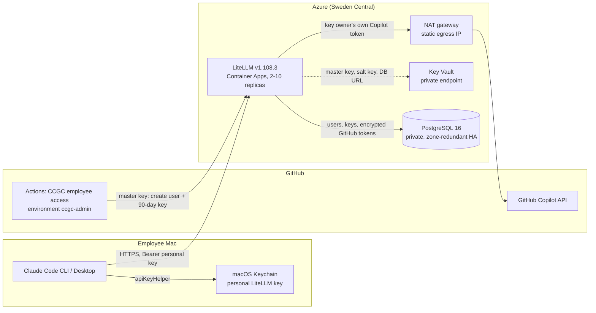

# Claude Code with GitHub Copilot

Run the official, unmodified Claude Code CLI (and Claude Desktop's Gateway
mode) with Claude models supplied by **each employee's own GitHub Copilot
seat**, through one central [LiteLLM](https://github.com/BerriAI/litellm)
gateway on Azure.

- Claude Code talks directly to LiteLLM with a **personal 90-day LiteLLM
  virtual key**. There is no broker, API Management, or custom authentication.
- LiteLLM's native **per-user GitHub Copilot OAuth** credential
  (`github-copilot-user`) resolves every request to the key owner's own GitHub
  connection, so one employee's key can never use another employee's Copilot
  plan.
- Enterprise IT issues and revokes keys from a protected **GitHub Actions**
  workflow. Employees run one macOS script, paste the key, and approve GitHub
  in their browser.

> The GitHub Copilot route is unofficial for this use. Organization and
> vendor-policy approval is required before production use.

## Architecture



| Step | What happens |
|---|---|
| Enroll | An administrator runs **Actions > CCGC employee access > enroll** with the employee's GitHub username. The workflow resolves the immutable GitHub account ID, creates or reuses a LiteLLM `internal_user`, and issues a 90-day key restricted to the Claude models and inference routes. |
| Set up | The employee runs `ccgc-enterprise-macos.sh enroll`, pastes the key, and approves GitHub's device flow, which the script starts through LiteLLM. The script checks that the connected GitHub login matches the key owner, verifies the model routes with a small inference request, stores the key in Keychain, and configures Claude Code. |
| Use | Claude Code sends the key to LiteLLM. LiteLLM authenticates it, applies model, budget, and rate policy, records spend under that user, and calls Copilot with that user's own GitHub connection. |
| Revoke | **Actions > CCGC employee access > revoke** disconnects the user's GitHub connection and deletes the LiteLLM user with all its keys. |

## Repository layout

| Path | Purpose |
|---|---|
| [`infra/main.bicep`](infra/main.bicep) | Subscription-scope entry point: resource group and LiteLLM platform |
| [`infra/modules/litellm.bicep`](infra/modules/litellm.bicep) | Container Apps, PostgreSQL, Key Vault, VNet, NAT, private DNS, Log Analytics |
| [`scripts/deploy.mjs`](scripts/deploy.mjs) | Administrator deploy: what-if preview, deployment, readiness, bootstrap, GitHub environment |
| [`scripts/litellm-bootstrap.mjs`](scripts/litellm-bootstrap.mjs) | Idempotently registers the per-user Copilot credential and Claude model routes |
| [`.github/workflows/ccgc-employee-access.yml`](.github/workflows/ccgc-employee-access.yml) and [`scripts/enterprise-actions-access.mjs`](scripts/enterprise-actions-access.mjs) | Employee enrollment and revocation |
| [`scripts/ccgc-enterprise-macos.sh`](scripts/ccgc-enterprise-macos.sh) | Standalone employee setup for macOS: `enroll`, `doctor`, `models`, `configure`, and `token` (Claude's key helper) |
| [`test/`](test) | Synthetic tests for every script |

## Getting started

- **Administrators:** follow the [enterprise runbook](docs/ENTERPRISE.md) to
  deploy, configure GitHub, and enroll or revoke employees.
- **Employees:** follow the [Mac guide](docs/mac/README.md). You need macOS,
  Claude Code `2.1.296` or newer, a Copilot-entitled GitHub account, and the
  key from Enterprise IT. No checkout, Node.js, or LiteLLM password is
  needed.

Development checks (Node.js 24, Azure CLI with Bicep):

```bash
npm ci
npm run check
npm test
az bicep build --file infra/main.bicep --stdout >/dev/null
az bicep lint --file infra/main.bicep
```

## Deployment status

The platform was rebuilt from scratch on the official
`ghcr.io/berriai/litellm:v1.108.3` image, pinned by digest. The previous
deployment (LiteLLM `1.108.0` with a separate broker and admission service)
was deleted, so every employee must enroll again. Deployment endpoints and
re-verification results are recorded in the
[enterprise runbook](docs/ENTERPRISE.md#current-deployment).

## Evidence

Evidence levels are kept separate. **Synthetic tests** cover the deploy,
bootstrap, enrollment, and macOS scripts with fake services. **Live evidence**
below was collected on the previous `1.108.0` deployment on 2026-11-08 with the
same LiteLLM per-user Copilot provider and direct personal keys. It must be
re-established on the rebuilt deployment and is not a claim about every
Copilot account.

| Client model ID | LiteLLM route | Previous live result |
|---|---|---|
| `claude-sonnet-5.5` | `github_copilot/claude-sonnet-5.5` | Messages API, Claude Code CLI Read workflow, and Desktop Code Read workflow passed |
| `claude-sonnet-5` | `github_copilot/claude-sonnet-5` | Messages API and CLI Read workflow passed |
| `claude-haiku-5.5` | `github_copilot/claude-haiku-5.5` | Messages API and CLI Read workflow passed |
| `claude-haiku-4.5` | `github_copilot/claude-haiku-4.5` | Messages API and CLI Read workflow passed |
| `claude-opus-5.5` | `github_copilot/claude-opus-5.5` | **Blocked upstream:** GitHub returned `model_not_supported` for the tested account; there is no fallback |

Other previous live results with direct keys: `/v1/models`, Anthropic
Messages, Chat Completions, and Responses passed. Claude Code `2.1.319` and
Claude Desktop `4.23118.0` (Gateway mode, Code tab) completed Read workflows.
A model outside the key's allowlist returned 403, a TPM limit returned 429,
spend was recorded, a revoked key returned 401, and an unconnected second user
returned 401 without reaching another user's connection.

Broader Claude Code features (Edit, Bash, subagents, hooks, compaction, image
and PDF input, adaptive thinking) were exercised against earlier gateway
architectures. Re-run them against the rebuilt gateway before relying on
them. Known model or client limits:

- Explicit fixed-budget thinking is rejected by the current Sonnet models, which require adaptive thinking.
- Claude Code omits the Advisor server tool whenever `ANTHROPIC_BASE_URL` points to a custom gateway.
- Auto mode uses Claude Code's local classifier (`CLAUDE_CODE_AUTO_MODE_SERVER=0`) instead of Anthropic-only server verdicts.

## Security properties

- One immutable GitHub account ID maps to one LiteLLM user, one per-user
  Copilot connection, and that user's keys. GitHub tokens are encrypted in
  PostgreSQL with the LiteLLM salt key, and LiteLLM uses them only for the
  key owner.
- Employee keys expire after 90 days and can call only the approved Claude
  models plus the inference, model-info, and own-connection routes. On the Mac
  they are stored only in Keychain, never in the profile or Claude settings.
- The LiteLLM master key is a protected GitHub environment secret limited to
  `main`. The administrator copy lives in a private `0600` file. Azure stores
  it in a Key Vault reachable only through a private endpoint.
- PostgreSQL has no public access. Outbound traffic leaves through one static
  NAT IP that GitHub organization IP allow lists can permit.
- The issued key is visible to readers of the Actions run summary. Restrict
  repository access and deliver keys through a private channel.

## Production gates

This is an enterprise pilot, not a production service. Production requires:

1. Organization and vendor approval for the unofficial Copilot route
2. Live re-verification on the rebuilt deployment, including two-user isolation, load, replica failure, and restore
3. Monitoring, privacy, cost, and capacity approval
4. Release, rollback, backup, disaster-recovery, and support runbooks
