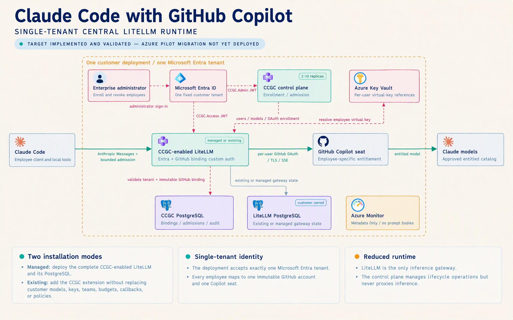
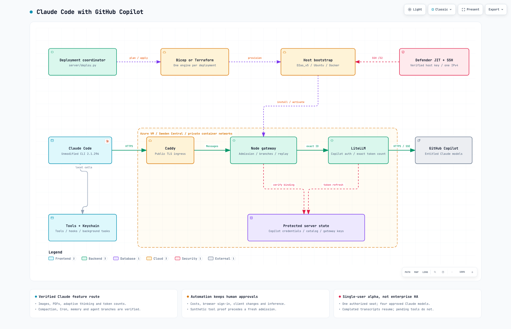

# Enterprise target and current-state diagrams

The enterprise target is split into **two separate diagrams**. Runtime contains
no CI/CD, IaC or setup flow; provisioning contains no inference topology.
The central-LiteLLM runtime is **implemented and locally validated but not yet
deployed**. The currently deployed pilot still runs the superseded
broker/worker topology. The provisioning diagram documents the governed path
from scope approval through either a full managed LiteLLM deployment or an
additive overlay on an existing customer LiteLLM.

| Enterprise diagram | Presentation PNG | Interactive HTML | Technical source |
|---|---|---|---|
| Runtime architecture | [GPT-image central-LiteLLM poster](ccgc-enterprise-runtime-poster-gpt-image.png) | [Interactive viewer](ccgc-enterprise-runtime-poster.html) | [Central-LiteLLM architecture JSON](ccgc-enterprise-runtime-poster.architecture.json) |
| Provisioning and rollout | [Provisioning poster](ccgc-enterprise-provisioning.png) | [Workflow viewer](ccgc-enterprise-provisioning.html) | [Workflow JSON](ccgc-enterprise-provisioning.workflow.json) |

The [PRD enterprise target contract](../PRD.md#enterprise-implementation-revision-022)
records the design rationale, implementation gaps, official Azure references
and production gates. These diagrams do not certify enterprise readiness.

## Enterprise runtime

The presentation poster was generated with the existing Azure OpenAI
`gpt-image-2.5-flare` deployment from the validated
[Archify desktop capture](ccgc-enterprise-runtime-poster.png) and official
Microsoft Azure service-icon references. The reviewed
[architecture JSON](ccgc-enterprise-runtime-poster.architecture.json) and
[interactive HTML](ccgc-enterprise-runtime-poster.html) remain the technical
authority; the GPT-image PNG is a presentation companion.

The primary request path is **Claude Code -> public single-tenant CCGC-enabled
LiteLLM -> the employee's GitHub Copilot seat -> entitled Claude models**.
Claude's local tools, hooks, and background execution remain local. A separate
CCGC control plane handles enrollment, administration, bounded admissions, and
revocation, but is not in the inference path.

In the managed branch, the current poster shows exactly one PostgreSQL Flexible
Server with separate `ccgc` and `litellm` schemas. In the existing-LiteLLM
branch, the customer database remains unchanged and CCGC retains its separate
solution-owned PostgreSQL server.

The LiteLLM custom-auth extension validates the fixed Entra tenant or hashes an
opaque CCGC credential, resolves the active immutable Entra-to-GitHub binding,
verifies the Key Vault secret's GitHub account ID, and returns that employee's
LiteLLM virtual key. Existing customer LiteLLM keys continue through native
authentication.

The compatibility labels reflect the latest verified implementation: images,
PDFs, adaptive thinking, exact token counts, coordinated agent branches,
background tasks, completed-turn resume, exact pending-tool restart, automatic
compaction, Cron lifecycle, and automatic-memory persistence are working.
Claude Code `2.1.296` does not expose an Advisor tool through this route.

Entra authenticates CCGC access, not Copilot entitlement. Each immutable
enterprise principal must be linked to that same employee's authorized GitHub
account. The control plane and LiteLLM use managed identities for narrowly scoped Key
Vault and CCGC PostgreSQL access. In managed mode, one PostgreSQL Flexible
Server uses a `ccgc` schema for bindings, enrollment state, admission budgets,
and audit intent, plus a `litellm` schema for virtual keys, encrypted OAuth
connections, and gateway state. Existing-LiteLLM mode retains the customer's
database and provisions a separate CCGC server. Azure Monitor collects
restricted metadata, never prompt/response bodies.

The private-workload outline is a logical boundary, not a subnet-placement map.
Key Vault is also an Azure managed service, reached privately. The JWT trust
arrow denotes token issuer/key validation, not per-request sign-in. The drawing
summarizes control dependencies rather than every authenticated internal hop.
Zone redundancy does not promise transparent stream recovery or exactly-once
upstream inference. Vendor permission, SSE/no-replay proof, scale and regional
recovery decisions remain explicit release gates.

## Enterprise provisioning and rollout

Read the eight numbered steps from left to right on the top row, then right to
left on the second row: scope approval, signed build/IaC plan, human approval,
private foundation, service deployment, per-user linking, acceptance, staged
rollout. Use **Bicep OR Terraform**, with one resource/state owner per environment.
Federated CI identity does not replace browser consent or live-test approval.

For the validated macOS path, per-user linking is performed with
[`scripts/ccgc-enterprise-macos.sh`](../../scripts/ccgc-enterprise-macos.sh).
The one-time enrollment code is issued by Enterprise IT; the employee authorizes
the assigned GitHub account, and the script verifies health, model discovery,
limits, and live inference before acknowledging enrollment.

Failed acceptance blocks promotion and revokes affected admissions. Recovery
requires a separately approved known-good release; a failed first install
remains blocked. Recovery is not an inference retry or a shortcut into rollout.
The existing [VM automation](../AUTOMATION.md) does not implement these enterprise
PaaS modules, per-user services or acceptance gates.

## Enterprise provenance and acceptance

| Evidence | Runtime | Provisioning |
|---|---|---|
| Frozen specification/HTML hashes and byte counts | [Delivery receipt](ccgc-enterprise-runtime.delivery.json) | [Delivery receipt](ccgc-enterprise-provisioning.delivery.json) |
| Desktop light/dark evidence | [Contact sheet](ccgc-enterprise-runtime.visual-check.html) | [Contact sheet](ccgc-enterprise-provisioning.visual-check.html) |
| Initial image brief | [Current Archify-first prompt](ccgc-enterprise-runtime-multiuser-litellm-presentation-v16.prompt.txt), [focused dependency correction](ccgc-enterprise-runtime-multiuser-litellm-presentation-v16-correction.prompt.txt), [Archify runtime prompt](ccgc-enterprise-runtime.prompt.txt), and historical prompts | [Provisioning prompt](ccgc-enterprise-provisioning.prompt.txt) |
| Image generation provenance | [Current central-LiteLLM GPT-image receipt](ccgc-enterprise-runtime-poster-gpt-image.receipt.json), [generation prompt](ccgc-enterprise-runtime-poster-gpt-image.prompt.txt), [focused icon correction](ccgc-enterprise-runtime-poster-gpt-image-correction.prompt.txt), and retained historical receipts | [Selected-image receipt](ccgc-enterprise-provisioning.receipt.json) |

The existing runtime PNG, HTML, delivery receipts, and visual captures document
the superseded revision 0.21 broker/worker architecture. They remain historical
engineering and presentation evidence and are not authoritative for revision
0.22. The reviewed
[central-LiteLLM architecture JSON](ccgc-enterprise-runtime-poster.architecture.json)
is the current technical source until replacement HTML and PNG artifacts are
generated. The previous
[v8 operator presentation](ccgc-enterprise-runtime-multiuser-litellm-presentation-v8.png),
[v7 light presentation](ccgc-enterprise-runtime-multiuser-litellm-presentation-v7.png),
and earlier
[native-connector Flare poster](ccgc-enterprise-runtime-multiuser-flare-v3.png)
are retained only as historical presentation artwork.

Inputs were sanitized Archify screenshots, official Azure service icons, and
architecture terminology, not credentials, account IDs, or actual private
endpoints. Authentication used the existing Azure CLI Entra identity. The
current poster used the existing `gpt-image-2.5-flare` deployment in the
Foundry resource; no enterprise gateway/client resource was deployed and no
Copilot inference was performed. Image token counts are not a cost quote or
Copilot usage.

Both enterprise HTML artifacts passed **9/9 showcase checks with 0 errors and 0 warnings**,
with desktop containment at 1440 x 900, 1600 x 1000, 1920 x 1080 and 2048 x 1320.
Both themes at the smallest and largest sizes were inspected. The current
runtime poster was inspected at native resolution and 1280 x 800 presentation
size.
The [enterprise visual review](ccgc-enterprise.review.json) records the result
and rubric scores separately; machine receipts retain their original
`visualReview: "pending"` fields.

The PNGs are presentation companions. The reviewed JSON and PRD define the
target; the implementation defines current behavior. GPT-image is only a
documentation tool, never a runtime service in this solution.

## Single-user alpha: current-state evidence

| Artifact | Use |
|---|---|
| [Interactive architecture](ccgc-automated-solution.html) | Authoritative component/relationship map, with light/dark themes, inspection and export. Open the standalone HTML in a browser. |
| [Current-state runtime image](ccgc-automated-solution.png) | Validated 2048 x 1320 Archify capture with the latest feature labels. |
| [Historical GPT-image poster](ccgc-automated-solution.gpt-image-v2.png) | Earlier 2560 x 1600 presentation artwork retained for provenance. |
| [Archify specification](ccgc-automated-solution.architecture.json) | Editable technical source for the interactive diagram. |
| [Delivery receipt](ccgc-automated-solution.delivery.json) | Exact specification/HTML SHA-256 hashes, byte counts and showcase acceptance. |
| [Desktop evidence](ccgc-automated-solution.visual-check.html) | Light/dark screenshots at 1440 x 900 and 2048 x 1320. |
| [Visual review](ccgc-automated-solution.review.json) | Separate inspection result for the HTML and final poster. |

### Reading the alpha architecture

**Runtime:** unmodified Claude Code calls Caddy over HTTPS. The Node gateway
enforces admission, replay protection, shared limits, and isolated agent
branches; LiteLLM connects to the same developer's entitled Anthropic models
through GitHub Copilot and supplies exact token counts. The arrows show
requests; streaming responses return over the same route. Images, PDFs,
adaptive thinking, Read/Edit/Bash, hooks, background tasks, and tool permissions
remain client-driven. There is no local inference proxy, direct Anthropic
inference credential, model/provider fallback, or shared Copilot account.

**Credentials:** Keychain stores the separate gateway renewal key. GitHub
credentials, the reviewed catalog and gateway keys remain in the protected
server volume. The state box is not a SQL database or Key Vault. In-memory
admissions are not durable across gateway restarts, but Claude can resend and
resume a completed transcript after explicit refresh and re-admission. Pending
tool batches cannot resume safely. Mode restrictions alone are not encryption.

**Setup:** one coordinator selects Bicep **or** Terraform for a new deployment,
then performs verified SSH installation, account linking, client configuration
and approved live verification with synthetic tool fixtures. The upper row is
a setup/control path, not additional inference services. Its installation arrow
summarizes installation of the runtime stack; it does not imply that only Node
is installed. Defender JIT grants one IPv4 `/32` a 55-minute SSH window.
Browser authorization and cost/client/inference approvals remain human gates.

This depicts the **implemented single-user alpha**, not the proposed enterprise
service. The existing gateway has live four-model and feature evidence; fresh deployments
through the new coordinator remain unexecuted. Sweden Central locates the host,
not necessarily provider inference. No Entra ID, APIM, HA or multi-user seat pool
is claimed. The older [`../architecture.html`](../architecture.html) is retained
as the historical local-adapter diagram.

### Alpha source grounding

The checked-in source and runbooks, rather than a model's self-description, define
the topology:

- [`server/compose.yaml`](../../server/compose.yaml) and
  [`server/Caddyfile`](../../server/Caddyfile): TLS ingress, internal services,
  private frontend/backend networks and shared protected state.
- [`src/remote-server.ts`](../../src/remote-server.ts),
  [`src/gateway.ts`](../../src/gateway.ts) and
  [`src/litellm.ts`](../../src/litellm.ts): admission, conversation guards and
  native provider transport.
- [`src/remote-client.ts`](../../src/remote-client.ts) and
  [`server/bootstrap.py`](../../server/bootstrap.py): client enrollment,
  Keychain, account binding and gateway-owned model catalog.
- [`server/deploy.py`](../../server/deploy.py),
  [`infra/bicep/main.bicep`](../../infra/bicep/main.bicep) and
  [`infra/terraform/main.tf`](../../infra/terraform/main.tf):
  the approval-gated dual-IaC setup.
- [Automation runbook](../AUTOMATION.md) and
  [post-provisioning runbook](../README.md): operational boundaries and evidence.

No public repository/revision is invented for Archify source links: this
checkout has no published pinned commit.

### Alpha image provenance and review

The existing Azure OpenAI **`gpt-image-2`**, model version **`2026-04-21`**, was
invoked twice using the existing Azure CLI Entra identity and the image-edit API.
No model deployment, RBAC/network change, gateway restart, client setting change
or new Copilot inference was performed for these diagrams.

Only sanitized architecture imagery and public product terminology were sent.
No repository source, credentials, account IDs, private paths or actual gateway
addresses were included in the image inputs.

The first historical edit used the validated HTML's large light-theme screenshot and
[initial prompt](ccgc-automated-solution.gpt-image.prompt.txt). Inspection found
that its bootstrap connector stopped at the Azure heading. One
[focused correction](ccgc-automated-solution.gpt-image-v2.prompt.txt) restored the
arrow into Node gateway and moved the heading out of its path. The v2 image was
the selected presentation artifact for that revision. The validated Archify PNG
is now the current-state image; both GPT images remain provenance artifacts.

[First-generation receipt](ccgc-automated-solution.gpt-image.receipt.json) and
[final-image receipt](ccgc-automated-solution.gpt-image-v2.receipt.json) bind the
reference images, prompts, output dimensions, SHA-256 hashes and API usage.
These are image-generation token counts, not Copilot usage or a cost quote.

The interactive architecture passed **9/9 showcase checks**, with **0 errors
and 0 warnings**. Desktop containment passed at 1440 x 900, 1600 x 1000,
1920 x 1080 and 2048 x 1320. Both themes at the smallest and largest sizes were
visually inspected; the final poster's text, boundaries, model list and
connection directions were also inspected. The automated capture/API receipts
intentionally retain `visualReview: "pending"`; the separate review record
documents the subsequent visual inspection rather than rewriting machine
evidence.

The GPT PNG is a historical AI-generated presentation companion, not an
editable substitute for the JSON/HTML. The current Archify PNG, reviewed
technical specification, and implementation define the latest state.
GPT-image is a documentation tool only, not part of the inference route.
