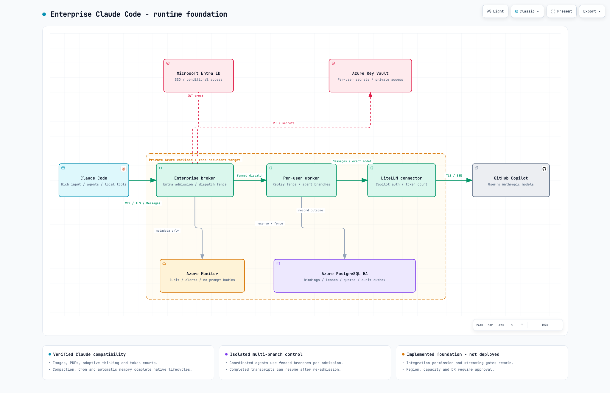
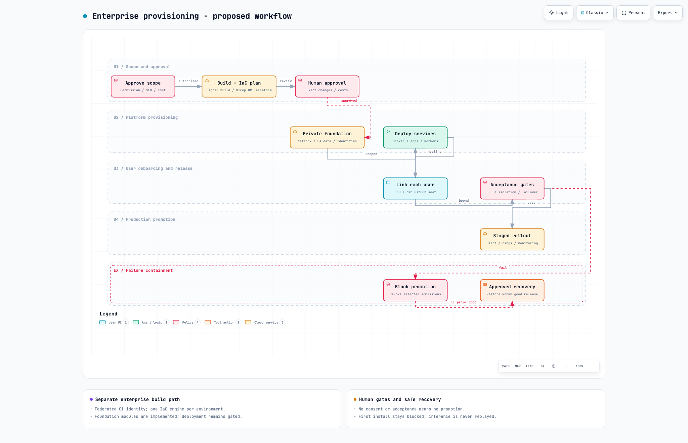

# Enterprise target and current-state diagrams

The enterprise target is split into **two separate diagrams**. Runtime contains
no CI/CD, IaC or setup flow; provisioning contains no inference topology.
The runtime foundation is **implemented and validated but not deployed**; the
full provisioning/lifecycle workflow remains proposed. The existing gateway and
Bicep/Terraform VM automation remain the single-user alpha documented below.

| Enterprise diagram | Presentation PNG | Interactive HTML | Technical source |
|---|---|---|---|
| Runtime architecture | [Validated runtime image](ccgc-enterprise-runtime.png) | [Runtime viewer](ccgc-enterprise-runtime.html) | [Architecture JSON](ccgc-enterprise-runtime.architecture.json) |
| Provisioning and rollout | [Provisioning poster](ccgc-enterprise-provisioning.png) | [Workflow viewer](ccgc-enterprise-provisioning.html) | [Workflow JSON](ccgc-enterprise-provisioning.workflow.json) |

The [PRD enterprise target contract](../PRD.md#enterprise-target-revision-017)
records the design rationale, implementation gaps, official Azure references
and production gates. These diagrams do not certify enterprise readiness.

## Enterprise runtime

The primary request path is **Claude Code -> private enterprise broker ->
isolated per-user worker -> LiteLLM connector -> GitHub Copilot -> Anthropic
models**. Native Messages and streamed responses follow this route; Claude's
Read/Edit/Bash, hooks, and background execution remain local. The worker owns
replay fencing and isolated agent branches. LiteLLM owns Copilot authorization,
model discovery, transport, and exact token counting.

The compatibility labels reflect the latest verified implementation: images,
PDFs, adaptive thinking, exact token counts, coordinated agent branches,
background tasks, completed-turn resume, automatic compaction, Cron lifecycle,
and automatic-memory persistence are working. Pending-tool resume remains
unsupported, and Claude Code `2.1.296` does not expose an Advisor tool through
this route.

Entra authenticates broker access, not Copilot entitlement. Each immutable
enterprise principal must be linked to that same employee's authorized GitHub
account. The broker uses managed identity to access user-bound secrets in Key
Vault; workers do not share account caches or receive vault-wide access.
PostgreSQL holds durable reservations, fenced ownership and audit intent.
Azure Monitor collects restricted metadata, never prompt/response bodies.

The private-workload outline is a logical boundary, not a subnet-placement map.
Key Vault is also an Azure managed service, reached privately. The JWT trust
arrow denotes token issuer/key validation, not per-request sign-in. The drawing
summarizes control dependencies rather than every authenticated internal hop.
Zone redundancy does not promise transparent stream recovery or exactly-once
upstream inference. Vendor permission, SSE/no-replay proof, scale and regional
recovery decisions remain explicit release gates.

## Enterprise provisioning and rollout

Read the eight numbered steps from left to right on the top row, then right to
left on the second row: scope approval, signed build/IaC plan, human approval,
private foundation, service deployment, per-user linking, acceptance, staged
rollout. Use **Bicep OR Terraform**, with one resource/state owner per environment.
Federated CI identity does not replace browser consent or live-test approval.

Failed acceptance blocks promotion and revokes affected admissions. Recovery
requires a separately approved known-good release; a failed first install
remains blocked. Recovery is not an inference retry or a shortcut into rollout.
The existing [VM automation](../AUTOMATION.md) does not implement these enterprise
PaaS modules, per-user services or acceptance gates.

## Enterprise provenance and acceptance

| Evidence | Runtime | Provisioning |
|---|---|---|
| Frozen specification/HTML hashes and byte counts | [Delivery receipt](ccgc-enterprise-runtime.delivery.json) | [Delivery receipt](ccgc-enterprise-provisioning.delivery.json) |
| Desktop light/dark evidence | [Contact sheet](ccgc-enterprise-runtime.visual-check.html) | [Contact sheet](ccgc-enterprise-provisioning.visual-check.html) |
| Initial image brief | [Archify runtime prompt](ccgc-enterprise-runtime.prompt.txt), [Flare prompt](ccgc-enterprise-runtime.flare.prompt.txt), [Flare caption correction](ccgc-enterprise-runtime-flare-v2.prompt.txt) | [Provisioning prompt](ccgc-enterprise-provisioning.prompt.txt) |
| Image generation provenance | [Initial receipt](ccgc-enterprise-runtime.receipt.json), [v2 receipt](ccgc-enterprise-runtime-v2.receipt.json), [Flare Azure-icon receipt](ccgc-enterprise-runtime-flare.receipt.json), [final Flare receipt](ccgc-enterprise-runtime-flare-v2.receipt.json) | [Selected-image receipt](ccgc-enterprise-provisioning.receipt.json) |

The current runtime and provisioning PNGs are the validated Archify light-theme
desktop captures, so their labels stay synchronized with the technical JSON and
interactive HTML. The earlier
[Azure-icon Flare poster](ccgc-enterprise-runtime-flare-v2.png) is retained as
historical presentation artwork and is no longer the current-state diagram.

Inputs were sanitized Archify screenshots and architecture terminology, not
repository source, credentials, account IDs or actual private endpoints.
Authentication used the existing Azure CLI Entra identity. A new
`gpt-image-2.5-flare` model deployment was created in the existing Foundry
resource for this documentation render; no enterprise gateway/client resource
was deployed and no Copilot inference was performed. Image token counts are not
a cost quote or Copilot usage.

Both enterprise HTML artifacts passed **9/9 showcase checks with 0 errors and 0 warnings**,
with desktop containment at 1440 x 900, 1600 x 1000, 1920 x 1080 and 2048 x 1320.
Both themes at the smallest and largest sizes were inspected. The selected
posters were inspected at native resolution and 1280 x 800 presentation size.
The [enterprise visual review](ccgc-enterprise.review.json) records the result
and rubric scores separately; machine receipts retain their original
`visualReview: "pending"` fields.

The PNGs are presentation companions. The reviewed JSON and PRD define the
target; the implementation defines current behavior. GPT-image is only a
documentation tool, never a runtime service in this solution.

## Single-user alpha: current-state evidence

| Artifact | Use |
|---|---|
| [Interactive architecture](ccgc-automated-solution.html) | Authoritative component/relationship map, with light/dark themes, inspection and export. Open the standalone HTML in a browser. |
| [Current-state runtime image](ccgc-automated-solution.png) | Validated 2048 x 1320 Archify capture with the latest feature labels. |
| [Historical GPT-image poster](ccgc-automated-solution.gpt-image-v2.png) | Earlier 2560 x 1600 presentation artwork retained for provenance. |
| [Archify specification](ccgc-automated-solution.architecture.json) | Editable technical source for the interactive diagram. |
| [Delivery receipt](ccgc-automated-solution.delivery.json) | Exact specification/HTML SHA-256 hashes, byte counts and showcase acceptance. |
| [Desktop evidence](ccgc-automated-solution.visual-check.html) | Light/dark screenshots at 1440 x 900 and 2048 x 1320. |
| [Visual review](ccgc-automated-solution.review.json) | Separate inspection result for the HTML and final poster. |

### Reading the alpha architecture

**Runtime:** unmodified Claude Code calls Caddy over HTTPS. The Node gateway
enforces admission, replay protection, shared limits, and isolated agent
branches; LiteLLM connects to the same developer's entitled Anthropic models
through GitHub Copilot and supplies exact token counts. The arrows show
requests; streaming responses return over the same route. Images, PDFs,
adaptive thinking, Read/Edit/Bash, hooks, background tasks, and tool permissions
remain client-driven. There is no local inference proxy, direct Anthropic
inference credential, model/provider fallback, or shared Copilot account.

**Credentials:** Keychain stores the separate gateway renewal key. GitHub
credentials, the reviewed catalog and gateway keys remain in the protected
server volume. The state box is not a SQL database or Key Vault. In-memory
admissions are not durable across gateway restarts, but Claude can resend and
resume a completed transcript after explicit refresh and re-admission. Pending
tool batches cannot resume safely. Mode restrictions alone are not encryption.

**Setup:** one coordinator selects Bicep **or** Terraform for a new deployment,
then performs verified SSH installation, account linking, client configuration
and approved live verification with synthetic tool fixtures. The upper row is
a setup/control path, not additional inference services. Its installation arrow
summarizes installation of the runtime stack; it does not imply that only Node
is installed. Defender JIT grants one IPv4 `/32` a 55-minute SSH window.
Browser authorization and cost/client/inference approvals remain human gates.

This depicts the **implemented single-user alpha**, not the proposed enterprise
service. The existing gateway has live four-model and feature evidence; fresh deployments
through the new coordinator remain unexecuted. Sweden Central locates the host,
not necessarily provider inference. No Entra ID, APIM, HA or multi-user seat pool
is claimed. The older [`../architecture.html`](../architecture.html) is retained
as the historical local-adapter diagram.

### Alpha source grounding

The checked-in source and runbooks, rather than a model's self-description, define
the topology:

- [`server/compose.yaml`](../../server/compose.yaml) and
  [`server/Caddyfile`](../../server/Caddyfile): TLS ingress, internal services,
  private frontend/backend networks and shared protected state.
- [`src/remote-server.ts`](../../src/remote-server.ts),
  [`src/gateway.ts`](../../src/gateway.ts) and
  [`src/litellm.ts`](../../src/litellm.ts): admission, conversation guards and
  native provider transport.
- [`src/remote-client.ts`](../../src/remote-client.ts) and
  [`server/bootstrap.py`](../../server/bootstrap.py): client enrollment,
  Keychain, account binding and gateway-owned model catalog.
- [`server/deploy.py`](../../server/deploy.py),
  [`infra/bicep/main.bicep`](../../infra/bicep/main.bicep) and
  [`infra/terraform/main.tf`](../../infra/terraform/main.tf):
  the approval-gated dual-IaC setup.
- [Automation runbook](../AUTOMATION.md) and
  [post-provisioning runbook](../README.md): operational boundaries and evidence.

No public repository/revision is invented for Archify source links: this
checkout has no published pinned commit.

### Alpha image provenance and review

The existing Azure OpenAI **`gpt-image-2`**, model version **`2026-04-21`**, was
invoked twice using the existing Azure CLI Entra identity and the image-edit API.
No model deployment, RBAC/network change, gateway restart, client setting change
or new Copilot inference was performed for these diagrams.

Only sanitized architecture imagery and public product terminology were sent.
No repository source, credentials, account IDs, private paths or actual gateway
addresses were included in the image inputs.

The first historical edit used the validated HTML's large light-theme screenshot and
[initial prompt](ccgc-automated-solution.gpt-image.prompt.txt). Inspection found
that its bootstrap connector stopped at the Azure heading. One
[focused correction](ccgc-automated-solution.gpt-image-v2.prompt.txt) restored the
arrow into Node gateway and moved the heading out of its path. The v2 image was
the selected presentation artifact for that revision. The validated Archify PNG
is now the current-state image; both GPT images remain provenance artifacts.

[First-generation receipt](ccgc-automated-solution.gpt-image.receipt.json) and
[final-image receipt](ccgc-automated-solution.gpt-image-v2.receipt.json) bind the
reference images, prompts, output dimensions, SHA-256 hashes and API usage.
These are image-generation token counts, not Copilot usage or a cost quote.

The interactive architecture passed **9/9 showcase checks**, with **0 errors
and 0 warnings**. Desktop containment passed at 1440 x 900, 1600 x 1000,
1920 x 1080 and 2048 x 1320. Both themes at the smallest and largest sizes were
visually inspected; the final poster's text, boundaries, model list and
connection directions were also inspected. The automated capture/API receipts
intentionally retain `visualReview: "pending"`; the separate review record
documents the subsequent visual inspection rather than rewriting machine
evidence.

The GPT PNG is a historical AI-generated presentation companion, not an
editable substitute for the JSON/HTML. The current Archify PNG, reviewed
technical specification, and implementation define the latest state.
GPT-image is a documentation tool only, not part of the inference route.
